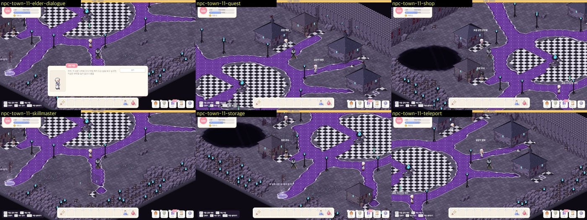
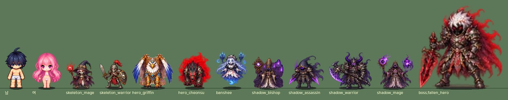
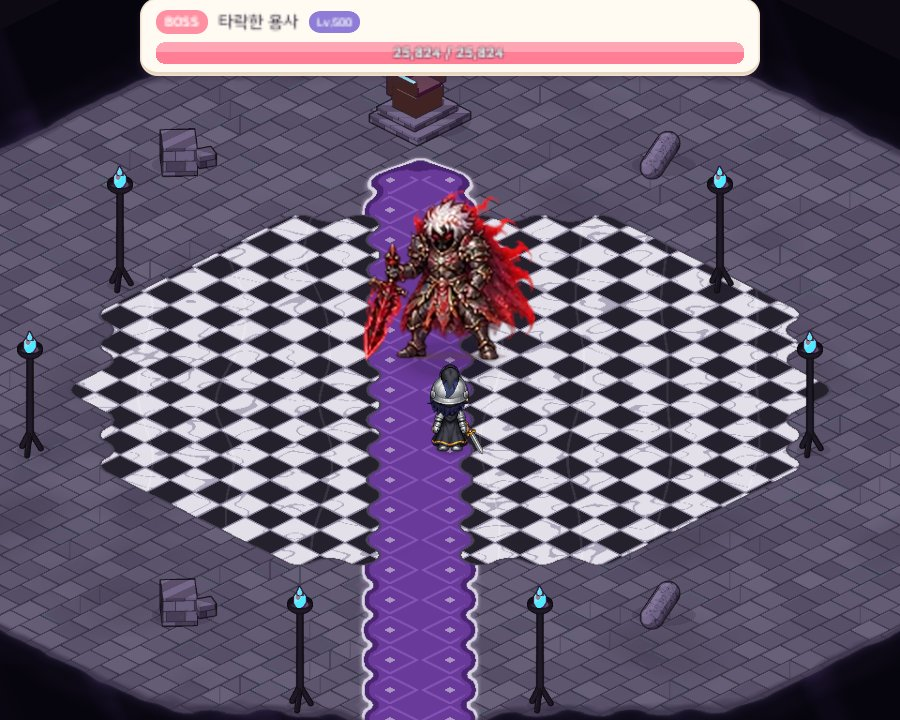
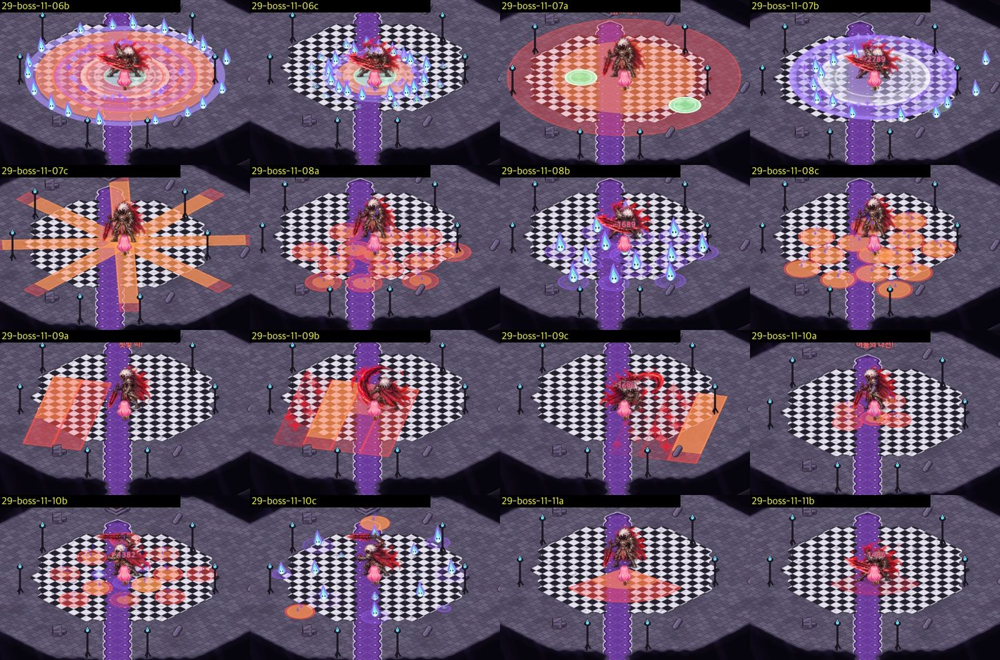
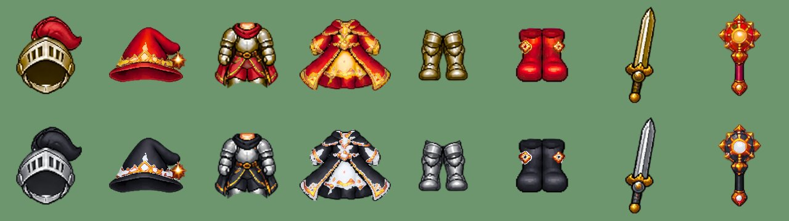
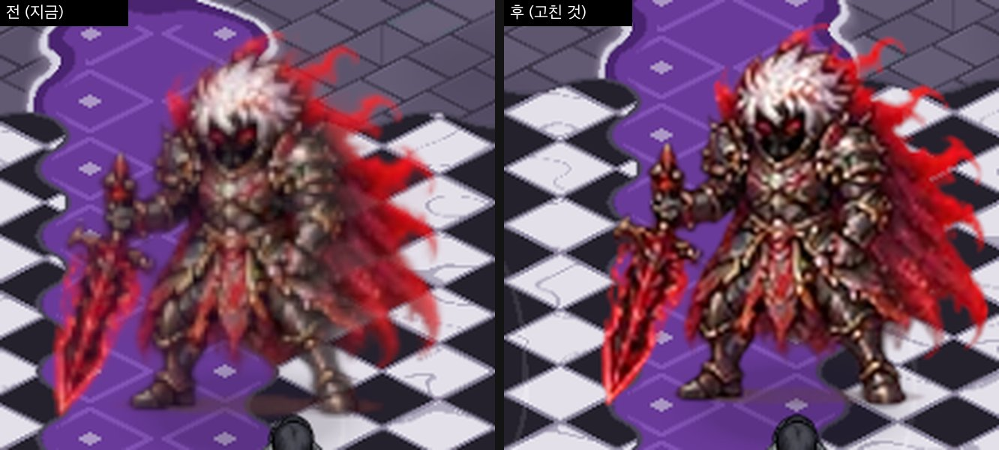
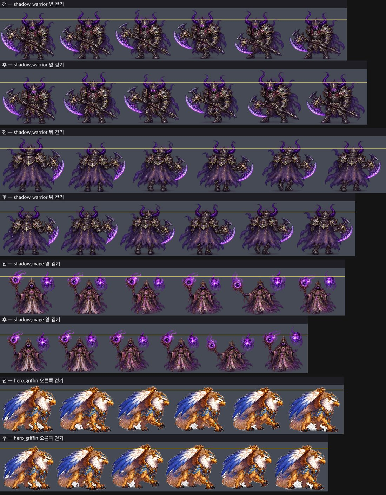
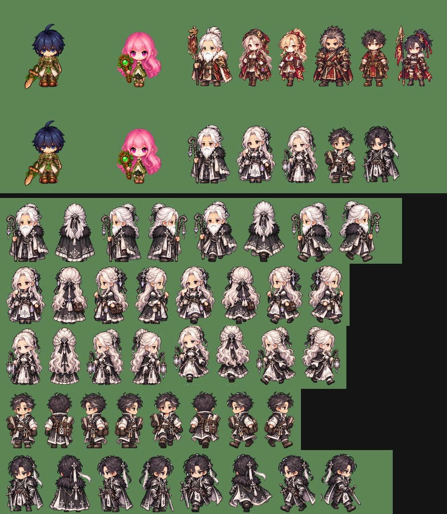

# 41. 지역 11 용사의 성 — 타락한 용사 Lv500 · 최고 레벨 500

드래곤 성 다음, 마지막 지역 **용사의 성**(Lv290~500)을 만들었다. 세상을 지키던 용사가 어둠에 타락해 옥좌에 앉은 성이다.
최종 보스 **타락한 용사 Lv500**에 맞춰 최고 레벨을 400에서 500으로 올렸다.
몬스터 · NPC 그림은 개발 노트 22번(몬스터)과 24~28 · 30번(NPC)에 받은 사용자 시트를 그대로 적용했다.

## 지역 구성

- **마을 실버게이트**: 은빛 성문 안, 여명 기사단이 지키는 마지막 마을이다.
  NPC 는 보급 상인 은방울 · 길잡이 별빛 · 열쇠지기 짤랑 · 여명 기사단장 세라 · 촌장 백운이다. 상점은 레어 Lv290 장비 세트와 성수 포션(HP 10000)을 판다.
- **사냥터 5곳** — 한 지역 안에서 구성이 겹치지 않게 골랐다.
  - 해골 병영(Lv290~297): 다층 개활지 — 공터 여러 개를 좁은 목으로 잇는다.
  - 그리핀 첨탑(Lv297~311): 섬 — 심연 위 땅들을 대리석 다리로 잇는다.
  - 통곡의 회랑(Lv311~325): 선형 통로 — 갈림길 없는 긴 회랑.
  - 그림자 예배당(Lv325~340): 미로.
  - 칠흑의 전당(Lv340~355): 개활지. 끝에 보스 필드 지기 견습 용사 하랑이 있다.
- **보스 필드 타락한 용사의 옥좌**: 뿔 투구 조각 5개 + 보랏빛 영혼석 5개를 내고 들어간다.
- **몬스터 10종**: 해골 매지션 · 해골 워리어 · 용사의 소환수 그리핀 · 용사의 소환수 천수 · 듀라한 · 밴시 · 섀도우 비숍 · 섀도우 어쌔신 · 섀도우 워리어 · 섀도우 매지션.
  듀라한은 지역 10에서 옮겨 왔고(Lv318), 지역 10 그 자리에는 갑옷과 방패를 든 **엘리펀트 탱커**(Lv258)를 새로 넣었다.
- 퀘스트 2개(그리핀 깃털 모으기 · 섀도우 매지션 사냥), 재료 아이콘 13종, 제작법(유니크 · 레전더리 · 미스틱), 영어 문구까지 함께 넣었다.

## 최고 레벨 500

경험치 · 능력치 공식은 그대로 500까지 이어진다.
몬스터 HP 는 "같은 레벨의 기준 플레이어가 기본 공격 몇 번에 잡는가"로 정한다. 레벨 251 이후 그 횟수가 너무 빨리 늘어 레벨 500에서 15번을 넘었다.
그래서 251 이후의 증가 속도를 조금 늦췄다 (레벨 400 ≈ 14.5번, 500 ≈ 14.8번). 이 때문에 레벨 400 몬스터 HP 는 0.7% 줄었다.

## 최종 보스 — 타락한 용사

- 큰 공격 **17종**, 큰 공격 간격 **1.8초** — 지금까지 보스 중 가장 많고 가장 빠르다.
- 피하기 어려움 점수(위험 넓이 × 판정 수 ÷ 예고 시간)는 1512로, 크림슨 로드 드래곤(1079)보다 10% 넘게 높다. 지역마다 지켜 온 난이도 곡선 규칙을 모두 통과한다.
- 앞 보스들에 없던 공격을 하나 더했다: 자기 둘레를 연달아 세 번 치는 공격.
- 연출은 핏빛 검기와 보랏빛 그림자 두 가지 색으로, 기존 연출을 새 색으로 칠해 6종을 만들었다.

## 새 맵 테마 — 어둠의 성

드래곤 성의 성벽 · 집 · 화로 모델을 그대로 쓰되, 그린 뒤에 **픽셀마다 어둡게 칠했다**.
돌 · 나무 · 쇠는 채도를 빼고 어둡게 + 보랏빛, 붉은 천은 짙은 보라, 밝게 타는 불은 푸른 혼불로 바꾼다.
바닥은 검보랏빛 판석 · 은테 두른 보랏빛 카펫 · 흑백 대리석이고, 드래곤 성의 용암 자리는 **바닥이 꺼진 심연**이 됐다.

## 장비 — 검정 + 흰색

지역 장비 그림은 부위 시트를 지역 색으로 칠해 만든다. 지역 11 색은 사용자가 고른 **검정 + 흰색**이다.
천은 검정, 장식은 흰색, 강철은 살짝 푸른 은빛이다. 새로 만든 장비 그림은 16장이고 기존 그림은 한 장도 바뀌지 않았다.

## 몬스터 시트 적용에서 생긴 일

### 배경이 있는 시트

그리핀 시트는 투명 표시용 회색 체크무늬가, 섀도우 비숍 시트는 까만 배경이 그림에 들어 있었다.
테두리에 닿았거나 아주 큰 배경 덩어리만 지워서, 그리핀의 흰 깃털과 비숍 두건 속 까만 얼굴은 남겼다.

### 타락한 용사가 흐리고 비쳐 보였다

플레이 화면에서 타락한 용사가 흐리고 살짝 투명해 보였다.
시트의 그림이 작아서(몸 키 약 90픽셀) 게임 화면에서 약 3배로 늘려 보였기 때문이다. 다른 보스는 1.3~2.6배다.
부드러운 알파 가장자리도 그만큼 넓게 번져 몸과 망토 너머로 바닥이 비쳤다.
이 보스만 빌드할 때 2배로 미리 키워 굽고, 가장자리를 다듬어 몸은 완전히 불투명하게, 색은 살짝 선명하게 했다.

### 걸을 때 커졌다 작아졌다

새 시트 여러 장이 한 방향의 걷기 칸을 서로 다른 크기로 그려 놓아서, 걸을 때 몸이 부풀었다 줄었다 했다 (섀도우 워리어 앞 · 뒤 첫 두 칸이 10% 크고, 섀도우 매지션 앞 다섯째 칸이 13% 크다).
도구에 이런 칸을 맞추는 기능이 있었지만 몸 둘레 상자로 재서 불꽃 · 망토 · 영혼 구슬 · 자세에 속았다. 몇 칸은 오히려 거꾸로 고치고 있었다.
새 시트는 칸끼리 발을 맞추고 **윗몸 그림의 무늬가 가장 잘 겹치는 배율**을 찾아 크기를 잰다.
칸 짝마다 배율을 재고 잘 맞는 짝을 더 믿는 방식으로 칸마다 크기를 풀어, 3.5% 넘게 다른 칸만 맞췄다. 칸끼리 크기 차이가 최대 13%에서 4% 안으로 줄었다.

## NPC

지역 11 NPC 는 지역 색 대신 모두 흑백 · 은빛 · 보랏빛 수정 차림이다. 촌장 · 상점 · 안내원 · 창고지기 · 보스 필드 지기 5장을 적용했다.

- 안내원 시트는 걷기 왼쪽 · 오른쪽 그림의 물결 머리끝이 몇 픽셀 사이로 붙어 있어 한 덩어리로 잡혔다. 보통 그림보다 너무 넓은 덩어리는 가운데 근처의 가장 얇은 세로줄에서 나누게 했다.
- 이름 · 말투는 그림에 맞춘다. 처음 지은 창고지기 "짐꾼 무쇠"는 그림이 열쇠 꾸러미와 책을 든 소년이라 **열쇠지기 짤랑**으로 바꿨다. 손에 등불을 든 안내원은 "제 등불을 따라오시면" 하고 길을 안내한다.
- 스킬마스터는 시트가 없다. 스킬마스터 NPC 는 없앨 예정이라 지역 11 스킬마스터는 코드로 그린 대체 모습으로 두었다.

## 확인

- 게임 규칙 테스트 263개 통과. 지역 표 · 보스 난이도 곡선 · 맵 크기 · 다국어 문구 검사 포함.
- 아트 검사 메뉴: NPC 시트 65장 · 몬스터 시트 109장 계약 통과.
- 실제 게임 화면 캡처: 마을 · 사냥터 몬스터 · 보스 큰 공격 49장 · 맵 전경.
- 직접 플레이하는 느낌(Lv500 보스 난이도, 레벨 355 → 500 구간 사냥 속도)은 아직 확인하지 못했다.
