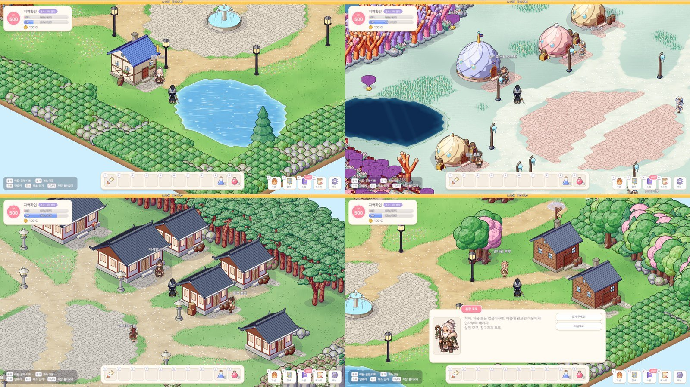

# 42. 스킬마스터 NPC 제거 — 스킬은 레벨업 · 전직 때 저절로

지금까지 새 스킬은 마을마다 한 명씩 있는 **스킬마스터 NPC** 에게 가서 배웠다. 레벨이 올라 새 스킬이 열리면 알림이 "마을의 스킬마스터를 찾아가 보세요"라고 했고, 마을로 돌아가 말을 걸고 창을 열어 "배우기"를 눌러야 했다.
이번 작업으로 스킬마스터 NPC 를 모든 마을에서 없애고, **스킬은 조건이 되면 저절로 배우게** 했다.

## 저절로 배우기

스킬마다 직업 · 전직 단계 · 필요 레벨이 있다. 이 조건이 맞는 스킬은 그 순간 레벨 1로 배운다.

- **레벨업**: 그 레벨에서 열린 스킬을 바로 배운다. 레벨업 알림 바로 뒤에 "새 스킬을 배웠어요: 더블 슬래쉬"가 뜬다.
  한 번에 여러 레벨이 오르면 그 사이에 열린 스킬을 모두 배운다.
- **전직**: 새 단계에서 지금 레벨로 배울 수 있는 스킬을 바로 배운다 ("1차 전직 완료! 새 스킬을 배웠어요: 헤이스트").
  아직 레벨이 모자라면 몇 레벨에 저절로 배우는지 알려 준다.
- **직업 고르기**: 새 캐릭터는 지금처럼 첫 스킬 하나를 배운다.
- **세이브 불러오기**: 스킬마스터에게 배우던 시절의 캐릭터는 조건이 맞는데 배우지 않은 스킬이 있다. 불러올 때 이런 스킬을 한꺼번에 배우고 알려 준다. 올려 둔 스킬 레벨과 스킬포인트는 그대로다.

배운 액티브 스킬은 단축키 앞쪽 빈 칸에 저절로 올라간다. 패시브는 배우자마자 늘 적용되므로 단축키에 올리지 않는다.
배우는 것은 예전처럼 공짜이고, 스킬 레벨은 스킬포인트로 올린다. 스킬창에는 아직 배우지 않은 스킬이 흐리게 보이고, "Lv.60에 저절로 배워요"처럼 언제 배우는지 적혀 있다.

레벨업 알림 순서도 맞췄다. 스킬은 캐릭터 데이터가 레벨업을 먼저 받아 배우고, 화면은 그 뒤에 레벨업 연출을 한다.
그래서 배운 스킬 알림을 잠깐 들고 있다가 "LEVEL UP" 알림 바로 뒤에 띄운다.

## 스킬마스터 NPC 정리

- 마을 9곳의 스킬마스터를 없앴다. 마을 NPC 는 촌장 · 상인 · 창고지기 · 안내원 네 역할이 한 명씩이다.
- **길드 마스터 오르카**(1차 전직)와 **대사범 무진**(2차 전직 시험)은 전직 퀘스트를 주는 NPC 라 남겼다. 역할을 "전직 NPC"로 바꾸고, 대화는 전직 퀘스트와 "전직이 뭔가요?"만 남겼다.
  "새 기술은 나에게서 배워 가게!" 같은 대사는 "새 기술이 벌써 몸에 배었을 걸세!"처럼 바꿨다.
- 첫 마을의 *버섯 갓 배달* 퀘스트는 버섯 갓을 스킬마스터 코코에게 전하는 퀘스트였다. 받는 사람을 상인 모모로 바꾸고 "모모가 버섯 갓으로 회복 물약을 만든대요"로 고쳤다.
- 스킬마스터 창, "지금 배울 스킬 있음" 머리 위 표시, 관련 문구(두 언어)를 지웠다.
- 쓰지 않게 된 스킬마스터 그림(게임용 아틀라스 8장 · 원본 시트 8장)은 게임 저장소에서 지웠다. 원본은 27번 노트에 남아 있다.

## 마을 배치는 그대로

마을 NPC 자리는 맵 설계 도구가 마을마다 정해진 난수 순서로 정한다. NPC 하나를 빼면 그 뒤의 난수 순서가 밀려, 다른 NPC · 집 · 장식물 자리까지 모두 바뀐다.
그래서 없앤 스킬마스터의 자리도 예전처럼 고르되, 거기에 NPC 를 세우지 않게 했다. 다시 만든 마을 맵 11장은 스킬마스터 한 줄만 빠지고 나머지는 한 칸도 바뀌지 않았다.

## 확인

- 게임 규칙 테스트 265개 통과. 새 테스트:
  - 레벨업으로 저절로 배우기 (다른 직업 스킬 · 전직 전 스킬은 배우지 않음, 핫바 빈 칸, 패시브는 핫바에 없음, 스킬포인트 그대로)
  - 전직하자마자 배우기, 옛 세이브를 불러오면 배우기
  - 마을 NPC 는 네 역할 + 전직 NPC 뿐
- 아트 검사: NPC 시트 57장.
- 마을 화면 캡처로 NPC 배치를 확인했다.
- 실제 플레이에서 레벨업 알림과 전직 NPC 대화창은 아직 직접 확인하지 못했다.
