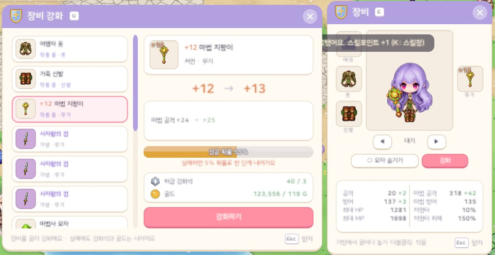
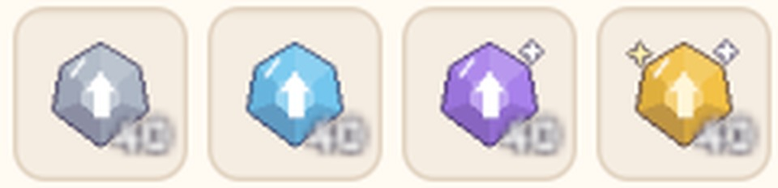
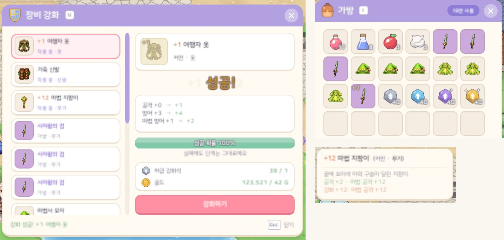

# 43. 장비 강화 — 강화석 4종 + 골드, 최대 +20

장비를 **강화**해 능력치를 올리는 기능을 만들었다. 강화에는 몬스터가 떨어뜨리는 **강화석**과 **골드**가 든다.
단계가 오를수록 성공률이 낮아지고, 높은 단계에서는 실패하면 단계가 내려갈 수도 있다.

## 강화석

강화석은 4종이다. 지역마다 쓰는 급이 다르다.

| 지역 | 강화석 |
|---|---|
| 1 · 2 · 3 (작은 산골동네 · 사막 · 해변가) | 하급 강화석 |
| 4 · 5 · 6 (바닷속 · 바위 동굴 · 산악 지역) | 중급 강화석 |
| 7 · 8 · 9 (얼음 지역 · 깊은 바다 심연 · 황무지 협곡) | 상급 강화석 |
| 10 · 11 (드래곤 성 · 용사의 성) | 최상급 강화석 |

- **몬스터 드랍으로만** 얻는다. 사냥터 몬스터는 4% 확률로 하나, 보스는 늘 3~5개를 떨어뜨린다.
- 상점에서 팔지도 사 주지도 않는다.
- 장비는 그 장비가 처음 나오는 지역의 강화석을 쓴다. 지역은 마을 상점 목록 · 보스 드랍 · 그 지역 제작법으로 정한다.
  뒤 마을 상점이 앞 마을 장비를 같이 팔아도, 그 장비는 앞 지역 장비로 본다.
- 몬스터 98종의 드랍 표에 한 줄씩 적지 않았다. 모든 지역을 등록한 뒤에 지역마다 사냥터 몬스터와 보스에 한꺼번에 붙인다.

아이콘은 다른 재료처럼 코드로 그린다. 여섯 면으로 깎은 돌 위에 오르는 화살표를 얹고, 급마다 색을 다르게 했다. 상급부터는 반짝이가 붙는다.

## 강화 규칙

- 단계는 +0부터 **+20**까지. 커먼을 포함한 모든 등급의 장비를 강화할 수 있다.
- 강화 한 번에 강화석과 골드를 낸다. **실패해도 재료는 사라진다.**
- 성공률은 4강까지 100%이고, 그 뒤로 단계마다 5%p씩 내려간다.
- **12 → 13강부터** 실패하면, 그중 5%는 한 단계 내려간다. 나머지 95%는 단계가 그대로다.

| 강화 | 성공률 | 실패하면 |
|---|---|---|
| 0 → 4 | 100% | — |
| 4 → 5 · 5 → 6 · … · 11 → 12 | 95% · 90% · … · 60% | 단계 그대로 |
| 12 → 13 · 13 → 14 · … · 19 → 20 | 55% · 50% · … · 20% | 5% 확률로 한 단계 하락 |

### 오르는 능력치

n강에 성공하면 장비의 기준 능력치 × n × 0.5%가 오른다 (반올림, 최소 1).
높은 단계일수록 많이 오르고, +20이면 주 능력치가 약 두 배(+105%)가 된다.

| 장비 | 오르는 능력치 |
|---|---|
| 검사 무기 (검) | 공격 |
| 법사 무기 (지팡이) | 마법 공격 |
| 검사 방어구 (투구 · 갑옷 · 장화) | 방어 + 마법 방어 + 조금의 공격 |
| 법사 방어구 (모자 · 로브 · 신발) | 방어 + 마법 방어 + 조금의 마법 공격 |

- "조금"은 방어 · 마법 방어 증가량의 1/3이다.
- 법사 방어구는 방어가 0인 것이 많다. 그래서 방어와 마법 방어 중 작은 쪽은 큰 쪽의 절반을 기준값으로 쓴다. 법사 방어구도 방어가 오르지만, 마법 방어가 더 많이 오른다.
- 검사용 · 법사용은 장비 그림을 고를 때와 같은 규칙으로 가른다. 마법 공격이 붙었거나, 방어 없이 마법 방어만 붙은 장비가 법사용이다.
- 아주 약한 장비(공격 +4 나무 검)도 강화에 성공할 때마다 1은 오른다.

### 비용

강화석 = 1개 × 등급 배수 × (1 + 단계 × 0.2)
골드 = 착용 레벨 몬스터 다섯 마리 몫의 골드 × 등급 배수 × (1 + 단계 × 0.2)

등급 배수는 커먼 1 · 레어 2 · 에픽 4 · 유니크 8 · 레전더리 16 · 미스틱 32다.
하락까지 넣어 +12 · +20까지 평균으로 드는 양을 계산해 보았다. 처음 정한 기본안이라 플레이하면서 다듬는다.

| 장비 | +12까지 (시도 약 15번) | +20까지 (시도 약 41번) |
|---|---|---|
| 나무 검 (지역 1 커먼) | 강화석 32 · 1,131 G | 강화석 145 · 5,039 G |
| 사자왕의 검 (지역 1 에픽 Lv18) | 강화석 130 · 3.6만 G | 강화석 575 · 15.8만 G |
| 해류 검 (지역 4 레어 Lv55) | 강화석 64 · 6.5만 G | 강화석 289 · 29만 G |
| 여명의 장검 (지역 11 레어 Lv290) | 강화석 64 · 78만 G | 강화석 289 · 347만 G |
| 신비의 어둠의 용사의 검 (미스틱 Lv500) | 강화석 1,034 · 3,234만 G | 강화석 4,608 · 1억 4천만 G |

## 강화 창

`U` 키 또는 장비창의 **강화** 버튼으로 연다. 장비창이 열려 있으면 그 왼쪽에 붙어서, 강화하면서 장비창의 능력치가 바뀌는 것을 같이 볼 수 있다.

- 왼쪽은 강화할 수 있는 장비 목록이다. 입은 장비가 먼저 오고, 가방의 장비가 뒤에 온다. **입은 장비도 벗지 않고 바로 강화한다.**
- 오른쪽에는 고른 장비가 나온다.
  - 지금 단계 → 다음 단계, 오르는 능력치 (지금 → 다음)
  - 성공 확률 막대와 "실패하면 어떻게 되는지" (12강부터는 주황색 하락 경고)
  - 드는 강화석 · 골드 (모자라면 주황) 와 **강화하기** 버튼
- 결과 연출: 성공하면 아이콘이 번쩍이고 "성공!"이 떠오른다. 실패하면 아이콘이 흔들리고, 하락하면 붉게 번쩍인다. +15를 넘겨 성공하면 화면 알림도 뜬다.
- 강화 한 번이 끝나면 바로 저장한다. 불러오기로 실패를 되돌릴 수 없게 하기 위해서다.

가방 · 장비창 · 상점 칸의 왼쪽 위에 `+N`이 붙는다. 단계가 오를수록 금빛 → 주황 → 분홍으로 바뀌고, +20은 하늘색이다.
툴팁에는 이름 앞의 `+N`과 함께 "강화 +12: 마법 공격 +12"처럼 강화로 오른 능력치가 따로 한 줄 나온다.

## 강화 단계는 장비를 따라다닌다

지금까지 가방 칸에는 아이템 id와 개수만 있었다. 같은 id의 장비는 모두 같은 물건이었다.
이제 가방 · 창고 칸과 장비칸마다 **강화 단계**가 있다. 장비를 입고 벗고, 칸을 옮기고, 창고에 맡겨도 단계는 그대로다.

- 같은 장비라도 강화 단계가 다르면 다른 물건이다. 한 칸에 합치지 않는다.
- 세이브 형식이 바뀌어 세이브 버전을 하나 올렸다. 예전 세이브의 장비는 모두 +0으로 읽힌다.
- 상점에 팔 때 강화한 장비는 단계마다 따로 한 줄(`+7 사자왕의 검`)이 된다. 값은 강화와 상관없이 같고, 팔기 전에 한 번 더 묻는다.
- 유니크 제작처럼 장비가 재료로 들어가는 제작은 강화하지 않은 장비부터 쓴다. 강화한 장비가 들어가게 되면 제작 창이 한 번 더 묻는다. 만든 장비는 +0이다.

## 확인

- 게임 규칙 테스트 281개 통과. 강화 테스트 16개를 새로 넣었다.
  - 성공률 표, 하락이 12 → 13강부터만 일어나는지, +20에서 멈추는지
  - 등급이 높을수록 · 단계가 높을수록 비용이 늘어나는지, 지역마다 맞는 강화석 급인지
  - 정해 둔 난수로 성공 · 실패 · 하락을 재현하고, 실패해도 재료를 쓰는지, 재료가 모자라면 아무것도 쓰지 않는지
  - 입은 채 강화하면 능력치가 바로 오르는지, 입고 벗기 · 칸 옮기기 · 창고 · 세이브에서 단계가 유지되는지, 예전 세이브는 +0인지
  - 강화한 장비 팔기, 제작 재료로 들어가는 순서
- 한국어 · 영어 화면 캡처로 강화 창 · 결과 연출 · 툴팁 · 가방 · 상점 팔기 탭을 확인했다 (한 줄 칸에서 넘친 글자 0곳).
- 실제 플레이에서 강화석이 모이는 속도와 비용이 적당한지는 아직 확인하지 못했다.
