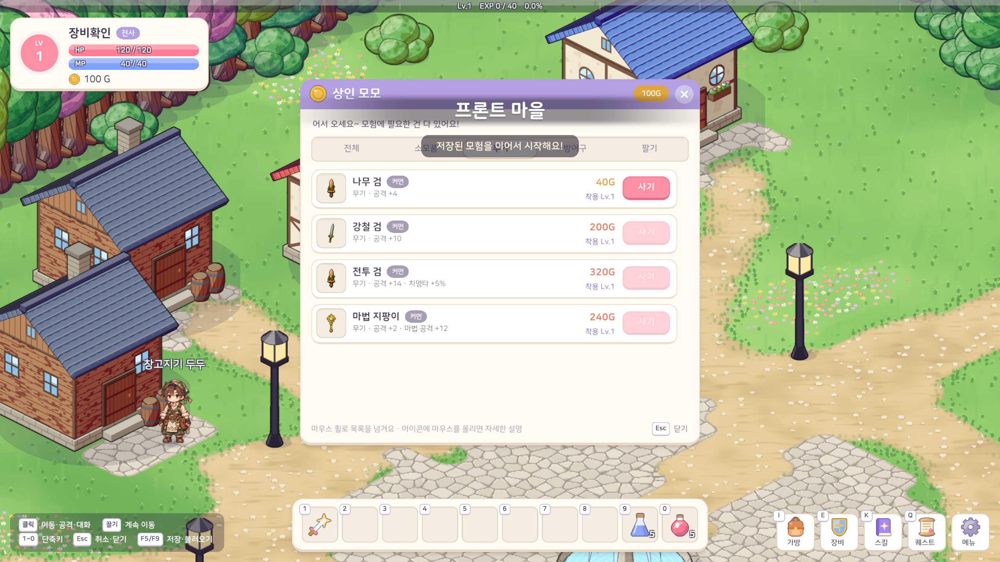
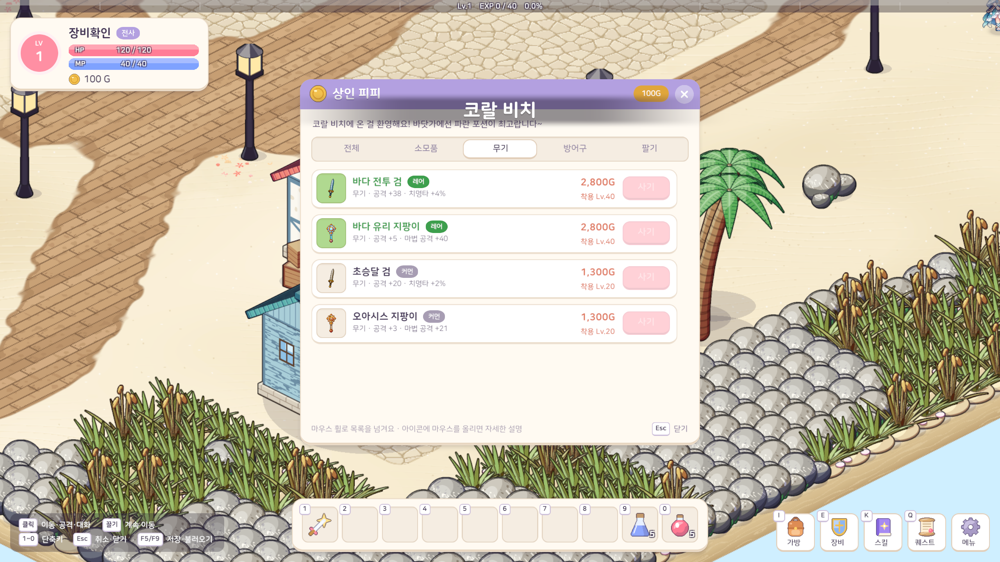
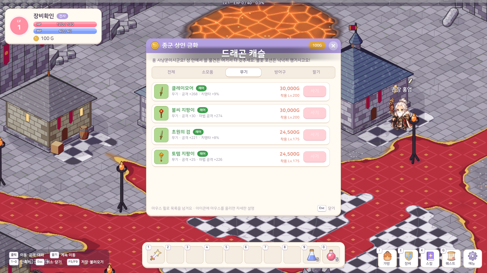
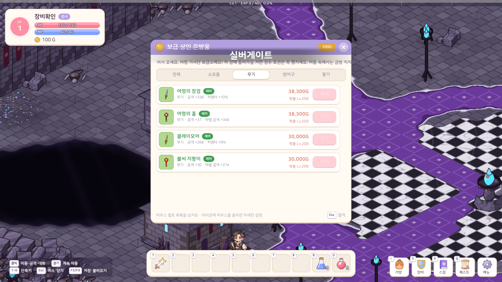

# 44. 지역별 장비 착용 레벨 통일

지역 1~11의 장비 착용 레벨을 상점·보스 드랍·제작품 모두 **지역마다 하나의 값**으로 맞췄다. 앞 지역의 장비를 뒤 마을 상점에서 다시 팔아도 그 장비의 원래 착용 레벨은 유지한다. GitHub 이슈 [#44](https://github.com/lgm1007/adventure-tale/issues/44)의 지역 11 값도 이미 구현된 용사의 성에 적용했다.

| 지역 | 이름 | 새 착용 레벨 |
|---:|---|---:|
| 1 | 작은 산골동네 | 1 |
| 2 | 사막 | 20 |
| 3 | 해변가 | 40 |
| 4 | 바닷속 | 60 |
| 5 | 바위 동굴 | 80 |
| 6 | 산악 | 100 |
| 7 | 얼음 | 125 |
| 8 | 깊은 바다 심연 | 150 |
| 9 | 황무지 협곡 | 175 |
| 10 | 드래곤 성 | 200 |
| 11 | 용사의 성 | 250 |

## 구현

`RegionGearLevels`에 11개 값을 모았다. 프론트 마을의 시작 장비는 Lv1이며, 각 지역의 상점·보스 장비 등록은 해당 지역 값을 사용한다. 에픽 보스 장비를 바탕으로 만든 유니크·레전더리·미스틱 장비도 바탕 장비와 같은 착용 레벨을 쓴다. 기존 세이브에 들어간 아이템 ID와 저장 형식은 바꾸지 않았다.

이미 입은 장비는 불러올 때 그대로 유지한다. 벗은 뒤 다시 입거나 새 장비를 입을 때는 현재 레벨을 검사한다. 기존 상점 창과 툴팁은 새 값을 그대로 표시하며, 레벨이 모자라면 주황색으로 보여 준다.

## 실제 Play 화면

아래 화면은 Unity 6000.6.2f1의 실제 Play 모드에서 상점 NPC 창을 열어 찍었다. 검증 캐릭터는 Lv1이고 세이브는 메모리에만 저장했다. 무기 탭에서 해당 마을 장비와 함께 파는 앞 마을 장비를 비교했다.

## 확인

- Unity 에디터에서 Core와 EditMode 테스트 어셈블리가 컴파일됐다.
- **EditMode 테스트 283개 통과, 실패 0개.** 지역별 상점·보스 드랍·제작품 레벨, 지역 순서, 옛 세이브의 착용 장비 유지와 재착용 제한을 확인했다.
- Play 화면의 Lv1·40·200·250 표시와 앞 지역 장비의 Lv20·175·200 유지를 확인했다. Lv1 캐릭터에게 높은 지역의 장비 레벨은 주황색이다.

강화 비용의 골드 기준은 장비의 착용 레벨을 읽는다. 이 변경으로 특히 보스 장비와 지역 10·11 장비의 강화 비용도 새 레벨 기준으로 계산된다. 강화 성공률·강화 단계·강화석 규칙은 그대로다. 이전 [43번 노트](43-equipment-enhancement.md)의 개별 장비 비용 예시는 당시 수치이므로, 현재 비용은 강화 창에서 확인해야 한다.
