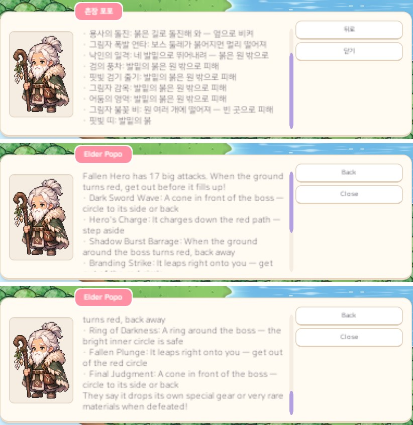
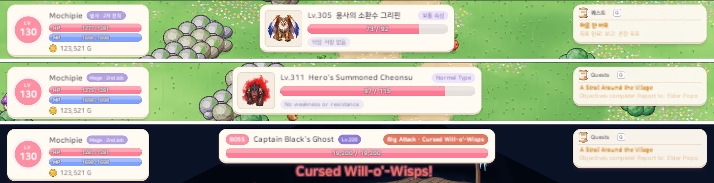

# 45. 버그 수정 — 긴 대사는 스크롤로, 긴 몬스터 이름은 넓힌 정보 칸에

화면 글자가 칸을 넘치던 두 곳을 고쳤다.

- NPC 대화창: 대사가 길면 본문이 창 아래로 넘쳐 끝부분을 읽을 수 없었다.
- 몬스터 정보 칸: 이름이 길면 오른쪽 위 속성 알약 밑으로 들어가 잘려 보였다.

두 곳 모두 영어에서 더 자주 넘쳤다. 영어 문장이 한국어보다 길기 때문이다.

## 대화창 — 칸 안에서 스크롤

대화창 본문 칸은 약 8줄 크기다. 이번에 어떤 대사가 칸을 넘는지 모든 대사를 재 보았다.

- 퀘스트 대사(부탁 · 받음 · 마침 + 보상 줄)는 두 언어 모두 칸 안에 들어간다.
- 넘치는 것은 **보스 필드 지기**의 대사다. 한국어 9개, 영어 18개가 넘쳤다.
  - "보스에 대해 묻기"는 큰 공격을 하나에 한 줄씩 설명한다. 뒤 지역 보스는 큰 공격이 11~17개라 칸의 두 배가 넘는다.
  - 입장 재료 안내도 뒤 지역에서는 재료 줄이 늘어 조금 넘친다.

보스 공격 설명은 줄일 수 없는 정보다. 그래서 대사를 나누지 않고 **본문 칸 안에 스크롤**을 넣었다. 상점 · 가방 창이 쓰는 스크롤 목록을 그대로 다시 썼다.

- 마우스 휠, 끌기, 오른쪽 스크롤 막대로 아래 내용을 본다.
- 글자가 한 글자씩 나오다 줄이 칸을 넘으면 **맨 아래를 따라 내려간다**.
- 위로 올려 앞부분을 읽고 있으면 따라 내려가지 않는다. 다시 맨 아래로 내리면 다시 따라간다.
- 본문이 칸 안에 다 들어가면 스크롤 막대가 숨어서 예전과 똑같이 보인다.
- 대화창을 누르면 남은 글자가 한 번에 나온다. 이때 보던 자리는 그대로라 이어서 읽을 수 있다. 끌어서 스크롤한 것은 누른 것으로 치지 않는다.
- 선택지를 누르면 예전처럼 남은 글자를 먼저 다 보여 준 뒤 다음으로 넘어간다.

글자 폭은 스크롤 막대 자리만큼 아주 조금(412 → 408) 줄었다.

## 몬스터 정보 칸 — 가장 긴 이름에 맞춘 폭

몬스터 정보 칸은 폭이 400으로 정해져 있었고, 이름 칸은 180이었다.
가장 긴 이름은 영어로 `Lv.311  Hero's Summoned Cheonsu`, 한국어로 `Lv.305  용사의 소환수 그리핀`이다. 둘 다 이 칸에 들어가지 않았다.

이제 화면을 만들 때 **모든 몬스터를 지금 언어로 재서** 가장 긴 줄이 들어가는 폭으로 칸을 정한다.

- 재는 줄은 두 개다. 하나는 레벨 · 이름 + 속성 알약, 다른 하나는 약점 · 저항 알약이다.
- 폭은 400 ~ 800 사이에서 정한다. 지금은 한국어 437, 영어 559다.
- 대상을 바꿀 때마다 폭이 달라지면 칸이 들썩거린다. 그래서 몬스터마다 바꾸지 않고 화면을 만들 때 한 번만 정한다.
- 언어를 바꾸면 화면을 새로 지으므로 그 언어로 다시 잰다.
- 새 몬스터를 더해도 숫자를 고칠 필요가 없다.
- HP 막대도 늘어난 폭만큼 같이 늘어난다.
- 이름 칸은 속성 알약 왼쪽에서 끝난다. 그래서 둘이 겹치지 않는다.

상한 800은 16:10 화면(UI 폭 약 1518)에서 정했다. 이 폭이면 왼쪽 상태창과 오른쪽 퀘스트 카드에 닿지 않는다.

같은 자리에 뜨는 **보스 막대**도 같이 확인했다. 보스 막대에는 오른쪽 위에 큰 공격 알림("큰 공격 · 공격 이름")이 뜬다.
이 알림이 이름 · 레벨과 부딪히는지 보스를 붙일 때 그 보스의 가장 긴 공격 이름으로 잰다. 부딪히면 막대를 넓힌다(기본 620, 최대 800).
지금 있는 보스는 모두 기본 폭에 들어간다.

## 확인

- 게임 규칙 테스트 281개 통과 (화면만 바뀌어 규칙 테스트는 그대로다).
- 한국어 · 영어 Play 화면 캡처에서 아래를 자동으로 검사했다.
  - 긴 대사(최종 보스의 큰 공격 17개 설명)
    - 글자가 나오는 동안 맨 아래를 따라가는지
    - 위로 올리면 멈추는지
    - 누르면 한 번에 펼쳐지고 보던 자리가 그대로인지
  - 짧은 대사에서는 스크롤 막대가 숨는지
  - 모든 몬스터 이름이 정보 칸 안에 들어가고 속성 알약과 겹치지 않는지
  - 정보 칸 · 보스 막대가 양옆 상태창 · 퀘스트 카드와 겹치지 않는지
  - 보스 막대의 이름 · 레벨 · 큰 공격 알림이 겹치지 않는지
- 한 줄로 만든 칸에서 두 줄로 넘친 글자는 0곳이다.
- 캡처는 16:9 화면에서 찍었다. 16:10 화면은 직접 찍지 않고 폭을 계산해 겹치지 않는지 확인했다.
- 실제 손으로 휠을 굴리고 끌어 보는 조작감은 아직 확인하지 못했다.
