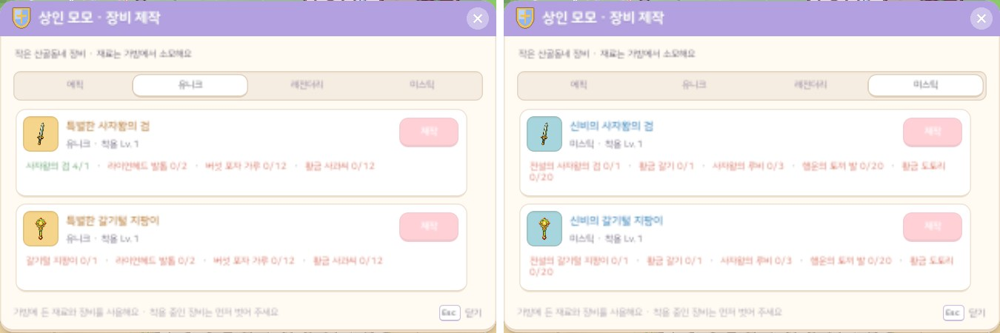
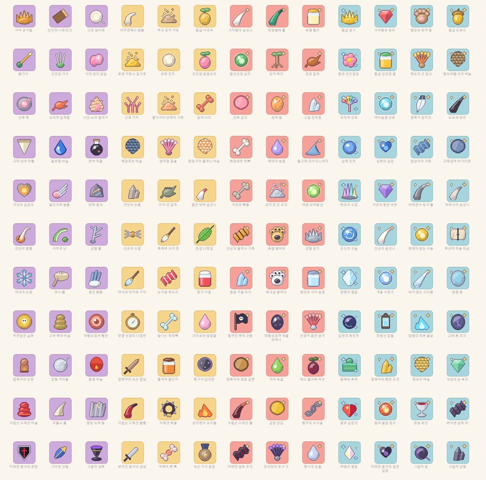

# 46. 장비 제작 재료를 등급마다 다르게

장비 제작에 쓰는 몬스터 재료를 **등급(에픽 · 유니크 · 레전더리 · 미스틱)마다 모두 다르게** 바꿨다.
지금까지는 같은 지역 안에서 네 등급이 같은 재료를 썼다. 등급이 오를 때마다 재료 수만 늘었다.

## 지금까지

지역마다 재료는 네 종이었다. 일반 재료 둘, 보스 재료 하나, 희귀 재료 하나다.

| 제작 등급 | 필요한 것 (작은 산골동네의 예) |
|---|---|
| 에픽 | 사자 갈기털 ×2 · 단단한 나뭇조각 ×8 · 고운 실타래 ×8 |
| 유니크 | 에픽 장비 + 사자 갈기털 ×2 · 나뭇조각 ×12 · 실타래 ×12 |
| 레전더리 | 유니크 장비 + 사자 갈기털 ×3 · 나뭇조각 ×16 · 실타래 ×16 |
| 미스틱 | 레전더리 장비 + 황금 갈기(희귀) + 사자 갈기털 ×3 · 나뭇조각 ×20 · 실타래 ×20 |

높은 등급을 만들려면 같은 몬스터 두 종만 계속 잡으면 됐다. 지역의 다른 몬스터를 찾아다닐 까닭이 없었다.

## 이제

등급마다 **사냥터 몬스터 재료 두 종 + 보스 재료 한 종**을 따로 둔다. 미스틱에는 지금처럼 희귀 재료가 하나 더 붙는다.

- 에픽 재료는 원래 재료 그대로다. 예전 세이브의 가방에 든 재료도 그대로 에픽 제작에 쓸 수 있다.
- 유니크 · 레전더리 · 미스틱마다 새 재료가 세 종씩 생겼다. 지역마다 9종, 11개 지역을 합쳐 **새 재료 99종**이다.
- 이제 지역마다 제작 재료는 13종이다 (에픽 3 · 유니크 3 · 레전더리 3 · 미스틱 3 + 희귀 1).
- 이전 등급 장비를 하나 넣어 다음 등급을 만드는 방식은 그대로다.

| 제작 등급 | 작은 산골동네 | 떨어뜨리는 몬스터 |
|---|---|---|
| 에픽 | 사자 갈기털 ×2 · 단단한 나뭇조각 ×8 · 고운 실타래 ×8 | 라이언헤드 · 나무군(Lv4) · 애벌레(Lv7) |
| 유니크 | 라이언헤드 발톱 ×2 · 버섯 포자 가루 ×12 · 황금 사과씨 ×12 | 라이언헤드 · 버섯몬(Lv2) · 사과몬(Lv5) |
| 레전더리 | 사자왕의 송곳니 ×3 · 딱정벌레 뿔 ×16 · 로열 젤리 ×16 | 라이언헤드 · 딱정벌레(Lv8) · 꿀버리(Lv9) |
| 미스틱 | 황금 갈기 ×1 · 사자왕의 루비 ×3 · 행운의 토끼 발 ×20 · 황금 도토리 ×20 | 라이언헤드 · 갈색 산토끼(Lv12) · 청설모(Lv15) |

### 누가 떨어뜨리나

- 새 사냥터 재료는 그 지역 몬스터가 **레벨 순서대로** 나눠 떨어뜨린다. 레벨이 낮은 몬스터는 유니크, 중간은 레전더리, 높은 몬스터는 미스틱 재료다.
  높은 등급을 만들려면 지역의 깊은 곳까지 가야 한다.
- 몬스터 한 종은 새 재료를 한 종만 떨어뜨린다. 원래 재료는 그대로 떨어뜨린다.
- 사냥터 재료의 드랍 확률은 유니크 40% · 레전더리 35% · 미스틱 30%다. 에픽 재료는 원래대로 45~55%다.
- 보스는 늘 에픽 보스 재료를 2~4개 떨어뜨린다. 높은 등급 보스 재료는 1~2개씩 떨어뜨리며, 확률은 유니크 60% · 레전더리 40% · 미스틱 25%다.
  미스틱 희귀 재료(5%)는 그대로다.
- 보스 입장 재료와 제작 재료는 겹치지 않는다.

필요한 수량은 예전과 같다. 일반 재료는 등급마다 8 · 12 · 16 · 20개, 보스 재료는 2 · 2 · 3 · 3개다.
재료가 등급마다 달라졌으니 수량을 같게 맞추는 방법도 있었지만, 높은 등급일수록 더 모아야 하는 흐름을 그대로 두었다.
드랍 확률과 수량은 플레이하면서 다듬는다.

### 이름 · 값 · 아이콘

- 새 재료의 이름은 떨어뜨리는 몬스터에 맞췄다. 예를 들어 꿀버리는 로열 젤리, 스노우 맨은 눈사람 목도리, 뱀파이어 집사는 핏빛 와인을 떨어뜨린다.
  보스 재료는 그 보스의 발톱 · 송곳니 · 비늘 · 깃발 · 등불 같은 것이다.
- 아이템 설명 끝 줄에는 어느 등급에 쓰는 재료인지 적었다 ("유니크 등급 장비 제작 재료"). 원래 재료의 설명도 "에픽 등급 장비 제작 재료"로 바꿨다.
- 상점에 팔 때 값은 등급 순서대로 오른다. 앞 등급 재료 중 가장 비싼 값의 1.5배 · 2.25배 · 3.4배다.
- 한국어 · 영어 이름과 설명을 모두 썼다.

아이콘 99개도 다른 재료처럼 코드로 그린다. 하나씩 따로 그리지 않고 **모양 함수 30여 개**를 만들어 색만 바꿔 썼다.
가루 · 씨앗 · 뿔 · 단지 · 발바닥 · 보석 · 수정 조각 · 구슬 · 비늘 · 천 · 메달 · 뼈 · 갑옷 조각 · 두루마리 · 룬 돌판 · 등불 · 사슬 · 칼날 · 잔 · 깃발 · 나침반 · 심장 · 수염 · 깃 장식 같은 모양이 있다.
등급이 높을수록 금빛 반짝이가 붙는다. 레전더리는 하나, 미스틱은 둘이다.

처음 그렸을 때 비늘 아이콘은 둥근 비늘을 겹쳐 놓아서 포도송이처럼 보였다.
방패꼴 판에 줄마다 반 칸씩 어긋난 반원 비늘 무늬를 칠하는 방식으로 바꿨다.
수염은 가는 호 몇 줄이라 눈에 잘 띄지 않았다. 그래서 가운데 매듭에서 양옆으로 휘어 뻗는 굵은 가닥으로 다시 그렸다.

## 데이터 구조

제작 표를 "지역 × 등급" 구조로 바꿨다.
지역 한 줄에 전사 · 법사 보스 무기, 희귀 재료, 등급마다 (사냥터 재료 둘 + 보스 재료 하나)를 적는다.
제작법 8개(두 직업 × 네 등급)는 이 표에서 만든다. 재료와 드랍은 지역 데이터 파일의 몬스터 · 보스 줄에 적는다.

## 확인

- 게임 규칙 테스트 287개 통과. 새 테스트는 다음을 확인한다.
  - 같은 지역 안에서 네 등급의 재료가 서로 겹치지 않고, 등급마다 사냥터 재료 둘 + 보스 재료 하나인지
  - 제작에 쓰는 모든 재료를 그 지역 몬스터나 보스가 실제로 떨어뜨리는지, 보스 입장 재료와 겹치지 않는지
  - 등급이 높을수록 재료 값이 비싸고, 떨어뜨리는 몬스터의 레벨이 높은지
  - 예전 재료가 에픽 제작법에 그대로 쓰이는지
- 한국어 · 영어 Play 화면 캡처로 제작 창의 네 탭과 재료 아이콘 표를 확인했다 (한 줄 칸에서 넘친 글자 0곳).
- 실제 플레이에서 재료가 모이는 속도가 적당한지는 아직 확인하지 못했다.
