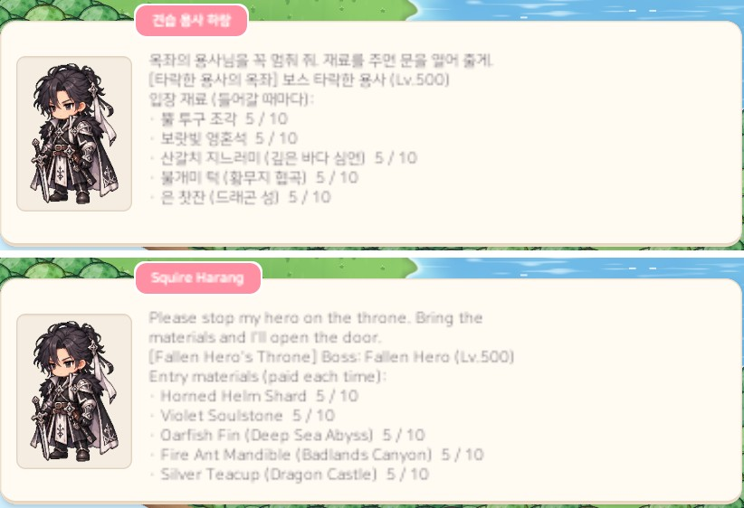

# 47. 보스 필드 입장 재료 — 뒤 지역일수록 종류 · 개수가 늘고 앞 지역 전리품도

보스 필드에 들어가려면 보스 안내 NPC에게 **입장 재료**를 낸다. 들어갈 때마다 낸다.
지금까지는 모든 지역이 똑같이 "그 지역 몬스터 전리품 2종 × 5개"였다. 그래서 지역이 올라가도 보스 필드를 여는 부담이 같았다.
이번에 **지역이 높을수록 재료 종류와 개수가 늘게** 바꾸고, 지역 4부터는 **앞 지역 몬스터의 전리품**도 넣었다.

## 입장 재료 표

자기 지역 전리품 2종은 예전 그대로 두었다. 종류가 3종 이상인 지역은 나머지를 앞 지역 전리품으로 채운다.

| 지역 | 종류 × 개수 | 앞 지역 전리품 |
|---|---|---|
| 1 작은 산골동네 | 2종 × 5 | — |
| 2 사막 | 2종 × 5 | — |
| 3 해변가 | 2종 × 6 | — |
| 4 바닷속 | 3종 × 6 | 고동 껍데기 (해변가) |
| 5 바위 동굴 | 3종 × 6 | 고래상어 가죽 (바닷속) |
| 6 산악 지역 | 3종 × 8 | 큰 쥐 앞니 (바위 동굴) |
| 7 얼음 지역 | 4종 × 8 | 바위게 등돌 (바위 동굴) · 강철 엄니 (산악) |
| 8 깊은 바다 심연 | 4종 × 8 | 표범 무늬 털가죽 (산악) · 북극곰 털 (얼음) |
| 9 황무지 협곡 | 4종 × 8 | 와플 콘 (얼음) · 산갈치 지느러미 (심연) |
| 10 드래곤 성 | 5종 × 10 | 아이스 바 막대 (얼음) · 물고기 뼈 (심연) · 흑기사 독침 (황무지) |
| 11 용사의 성 | 5종 × 10 | 산갈치 지느러미 (심연) · 불개미 턱 (황무지) · 은 찻잔 (드래곤 성) |

한 번 들어갈 때 내는 양은 지역 1의 10개에서 지역 11의 50개까지 늘어난다.

### 앞 지역 전리품을 고른 기준

- 이미 지나온 **앞 지역**의 전리품만 쓴다. 아직 못 간 지역의 재료를 요구하면 들어갈 수 없기 때문이다. 앞 지역은 바로 앞 세 지역 안에서 고른다.
- 앞 지역마다 한 종씩만 쓴다.
- 그 지역의 입장 재료, 장비 제작 재료, 퀘스트 수집품은 쓰지 않는다. 한 재료를 두 곳에서 서로 빼앗지 않게 하기 위해서다.
- 그 가운데 레벨이 높은 몬스터의 대표 전리품을 골랐다. 이 재료들은 지금까지 상점에 파는 것 말고는 쓸 곳이 없었다.
- 고른 재료의 설명 끝에 어느 보스 필드의 입장 재료인지 적었다. 두 보스가 같이 쓰는 산갈치 지느러미에는 두 줄을 적었다.
- 드랍 확률은 그대로다. 낮은 지역 마을은 안내원 NPC로 바로 갈 수 있다.

## 대화창

입장 재료가 5줄까지 늘어나면서 보스 안내 대화가 대화 칸(약 9줄)을 넘쳤다.
인사말 2~3줄, 빈 줄, 보스 줄, 재료 5줄이 이어져서 영어에서는 최대 6줄이 넘쳤다. 스크롤로 읽을 수는 있지만, 정작 중요한 재료 목록이 칸 아래로 밀렸다.

- 보스 안내 NPC의 인사말을 한 줄로 줄였다. 예전 인사말은 "흰 토끼털이랑 도토리를 모아 오면…"처럼 재료 이름을 말해서, 재료가 바뀌면 대사도 틀리게 됐다.
  이제는 "재료를 주면 문을 열어 줄게"처럼 이름 없이 말하고, 재료는 바로 아래 목록에서 본다. 재료가 바뀐 지역 4~11만 바꿨다.
- 인사말과 보스 줄 사이의 빈 줄을 없앴다.
- 앞 지역 전리품 줄 끝에는 어느 지역에서 나오는지 붙였다. 예: `· 불개미 턱 (황무지 협곡)  5 / 10`.
  이 출처는 데이터에서 "그 전리품을 처음 떨어뜨리는 지역"을 찾아 붙인다.

이렇게 고친 뒤 11개 지역 보스 안내 대사를 두 언어로 모두 재 보았다. 모두 대화 칸 안에 들어간다.

## 확인

- 게임 규칙 테스트 290개 통과. 새로 넣거나 바꾼 테스트는 다음을 확인한다.
  - 지역마다 종류 수 · 개수가 표대로이고, 지역이 높아질수록 줄지 않는지
  - 자기 지역 2종은 그 지역 사냥터 몬스터가, 나머지는 앞 지역(바로 앞 세 지역 안, 지역마다 한 종) 몬스터가 실제로 떨어뜨리는지, 대화 줄에 출처가 붙는지
  - 입장 재료가 제작 재료 · 퀘스트 수집품과 겹치지 않는지
  - 5종 입장에서 한 종류라도 모자라면 아무것도 가져가지 않고, 다 있으면 다섯 종을 모두 가져가는지
- 한국어 · 영어 Play 화면 캡처로 5종 입장 대화를 확인했다 (한 줄 칸에서 넘친 글자 0곳).
- 들어갈 때마다 50개를 내는 마지막 지역이 반복 사냥에 너무 무거운지는 실제로 플레이하며 봐야 한다.
  무거우면 "한 번 내면 일정 시간 다시 들어갈 수 있게" 같은 규칙을 더할 수 있다.
