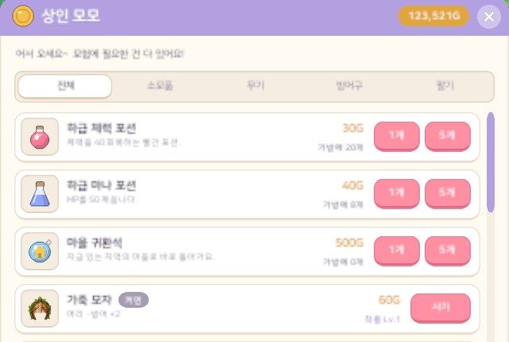
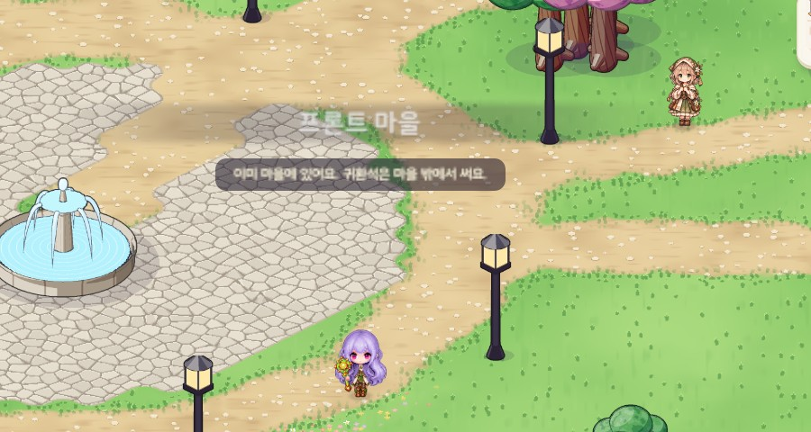

# 49. 마을 귀환석

사냥을 마치고 마을로 돌아가려면 사냥터 몇 개를 걸어서 되돌아가야 했다. 사냥터 하나가 100x100칸쯤이라 꽤 오래 걸린다.
그래서 상점에서 **마을 귀환석**을 팔고, 쓰면 **지금 있는 지역의 마을로 바로** 돌아가게 했다.

## 어떻게 쓰나

- 어느 마을의 상인에게서나 산다. 값은 모든 지역이 같은 500G이고, 팔면 다른 소모품처럼 절반(250G)을 받는다.
- 상점 목록에서는 포션 바로 뒤에 온다.
- 포션처럼 겹쳐서(99개까지) 가방에 들고 다닌다. 가방에서 더블클릭하거나 핫바에 올려 숫자 키로 쓴다.
- 쓰면 하나가 줄고, 다른 맵으로 갈 때처럼 화면이 어두워졌다 밝아지며 그 지역 마을의 시작 칸에 선다. 도착하면 마을 이름 띠가 뜬다.
- 가는 마을은 **기절하면 눈을 뜨는 마을과 같은 곳**이다. 사막의 사냥터에서 쓰면 오아시스 마을로, 용사의 성 사냥터에서 쓰면 실버게이트로 간다.
- 마을 안에서 쓰면 이동하지 않고 귀환석도 줄지 않는다. 대신 "이미 마을에 있어요. 귀환석은 마을 밖에서 써요." 알림이 뜬다.

## 정한 것

- **가격**: 모든 지역 같은 값(500G)이다. 걸어서 돌아가는 수고를 덜어 주는 물건이라 포션보다 훨씬 비싸게 두었다. 첫 지역에서는 꽤 큰 돈이라 아껴 쓰게 되고, 뒤 지역으로 갈수록 부담이 줄어든다.
- **보스 필드에서도 쓸 수 있다**: 보스전이 힘들면 귀환석으로 빠져나올 수 있다. 다만 보스 필드에 들어갈 때 낸 입장 재료는 돌려주지 않는다. 다시 들어가려면 재료를 또 내야 한다.
- **제한 없이 바로**: 시전 시간이나 재사용 대기 없이 누르는 순간 이동한다. 맵 이동 중에는 쓰지 않아서 귀환석이 헛되이 줄지 않는다.
- **얻는 방법**: 상점에서 사는 것뿐이다. 새 캐릭터에게 주지 않고, 몬스터도 떨어뜨리지 않는다.
- **규칙은 게임 규칙 쪽에**: "어느 마을로 가는지 · 마을 안인지 · 하나 빼기"는 화면과 떨어진 순수 규칙 함수다. 이동과 연출만 게임 쪽이 맡는다.
  아이템에는 "쓰면 마을로 돌아간다"는 효과 값을 두었다. 포션이 회복량 값을 가진 것과 같은 방식이다.

## 아이콘

다른 아이템처럼 코드로 그렸다. 하늘빛 둥근 돌 가운데에 금빛 집(세모 지붕 · 몸 · 문)을 새기고, 둘레에 옅은 빛과 반짝이를 둘렀다.

## 확인

- 게임 규칙 테스트 299개 통과. 새로 넣은 테스트 3개는 다음을 확인한다.
  - 모든 지역의 상점이 같은 값으로 팔고, 팔면 절반인지
  - 모든 지역의 모든 사냥터와 보스 필드에서 쓰면 그 지역 마을(기절하면 눈을 뜨는 곳)로 가고 하나만 줄어드는지
  - 마을 안에서는 줄지 않는지, 귀환석이 없거나 다른 아이템이면 쓰이지 않는지
- 한국어 · 영어 Play 화면 캡처로 확인했다.
  - 사냥터에서 쓰면 마을 시작 칸에 도착하고 하나가 줄어드는지, 마을 안에서 쓰면 그대로인지를 캡처 중에 검사했다.
  - 상점 목록과 아이콘도 함께 보았다.
- 실제로 손으로 눌러 보는 확인은 아직 하지 않았다.
