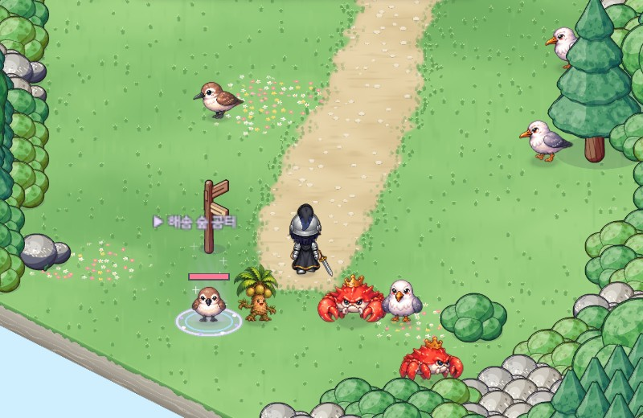
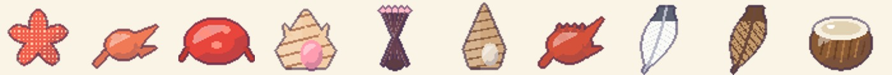
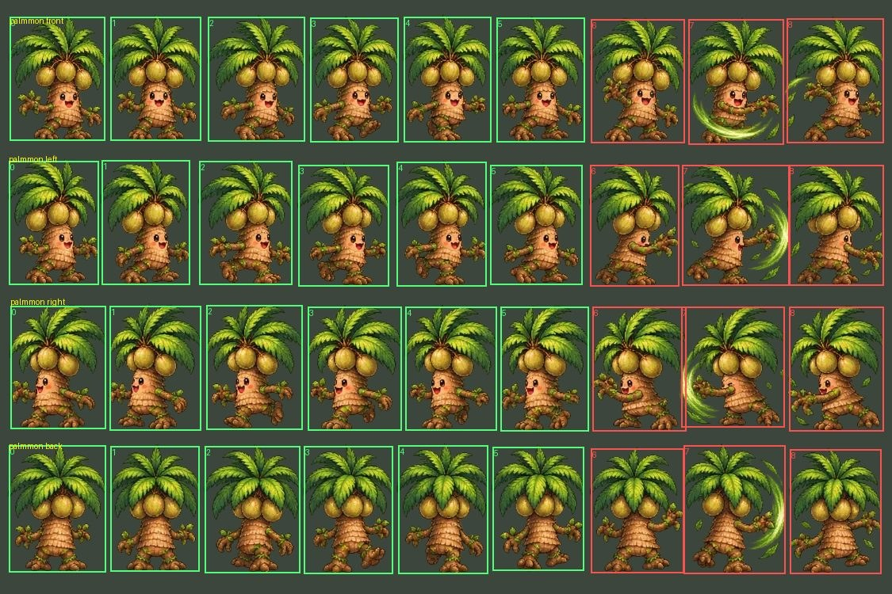
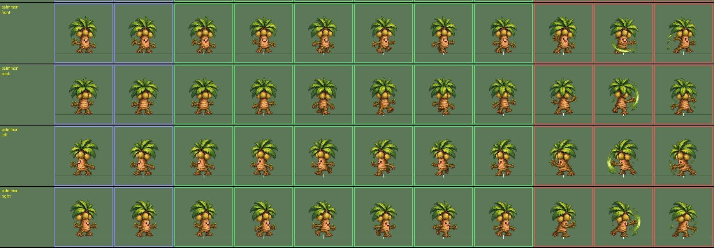
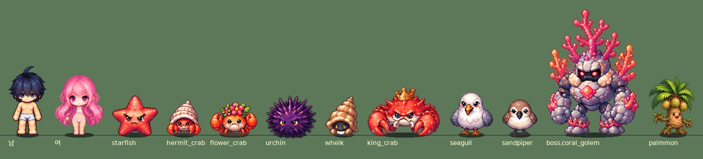

# 50. 해변가 몬스터 개편 — 소라군을 빼고 야자수몬을 넣다

[22번 노트](22-monster-style-redesign-plan.md)의 「지역 3 변경」 기획을 게임에 적용했다.
지역 3(해변가)의 몬스터 레벨을 새로 정하고, **소라군을 없애고 새 몬스터 야자수몬을 넣었다.** 필드 몬스터는 그대로 9종이다.

## 새 몬스터 표

| 몬스터 | 레벨 | 선공 | 속성 | 바뀐 것 |
|---|---|---|---|---|
| 스타피쉬 | 29 | 후공 | 물리 강점 / 마법 약점 | 그대로 |
| 소라게 | 31 | 후공 | 물리 약점 / 마법 강점 | 그대로 |
| 꽃게 | 33 | 선공 | 물리 약점 / 마법 강점 | 그대로 |
| 성게군 | 34 | 선공 | 물리 강점 / 마법 약점 | 37 → 34 |
| 고동군 | 37 | 후공 | 물리 약점 / 마법 강점 | 39 → 37 |
| 킹크랩 | 40 | 선공 | 물리 강점 / 마법 약점 | 41 → 40 |
| 해안 갈매기 | 42 | 선공 | 없음 | 43 → 42 |
| 해안 도요새 | 44 | 선공 | 없음 | 45 → 44 |
| **야자수몬** (새로) | 46 | 후공 | 없음 | 새 몬스터 |
| ~~소라군~~ | ~~34~~ | | | 없앰 |

성향 · 속성은 원래 데이터가 새 기획과 같아서 레벨만 바꿨다. 몬스터 능력치는 손으로 적지 않고 레벨 공식이 다시 계산한다.

## 소라군을 없애며 챙긴 것

- **떨어뜨리던 재료**: 소라군의 *나선 소라 껍데기*는 에픽 장비 제작 재료라, 그냥 지우면 제작이 막힌다.
  레벨이 가장 낮은 성게군이 이어받아 떨어뜨린다. 설명도 "성게군이 가시에 꽂아 짊어지고 다니던 소라 껍데기"로 바꿨다 (실제 성게도 가시에 조개껍데기를 붙이고 다닌다).
  아이템 id는 그대로라 옛 세이브 가방의 소라 껍데기도 그대로 쓰인다.
- **사냥터 자리**: 소라군이 있던 *썰물 갯벌*과 *갯바위 해안*은 몬스터 수를 그대로 두고, 남은 몬스터가 소라군 몫을 나눠 가진다.
  - 썰물 갯벌: 꽃게 12 · 소라군 16 · 성게군 15 → 꽃게 20 · 성게군 23
  - 갯바위 해안: 소라군 15 · 성게군 16 · 고동군 14 → 성게군 23 · 고동군 22
- **그림**: 소라군 그림은 다른 두 몬스터(성게군 · 고동군)와 같은 시트에 들어 있다. 시트를 자를 때 블록 자리를 맞춰야 해서
  시트 표에는 그대로 두고 "쓰지 않는 몬스터"로 표시했다. 아틀라스는 만들지 않고, 예전 아틀라스는 지웠다.
- 예전 3D 도형 인형(그림이 없을 때 쓰던 대체 모습)의 소라군 조립 코드도 지웠다.
- 퀘스트에는 소라군을 쓰는 곳이 없었다.

## 야자수몬

코코넛 세 개가 달린 잎 머리에 야자나무 몸통, 뿌리 발로 걷는 나무 몬스터다. 지역 1의 씨앗몬 · 버섯몬처럼 식물형이라 후공이다.

- **어디에**: 가장 레벨이 높은 사냥터 *갈매기 곶*(킹크랩 · 갈매기 · 도요새와 함께, 12마리). 사냥터 레벨 표시는 Lv 41~45 → Lv 40~46이 되었다.
- **드랍**: 새 일반 재료 *야자 열매 껍질*(반으로 쪼갠 코코넛 껍질 — 아이콘도 코드로 그렸다)과 파란 포션.
  제작 재료 · 입장 재료와 겹치지 않게 새로 만들었다.

### 시트 자르기

시트는 가로 9칸 × 4줄(앞 · 왼쪽 · 오른쪽 · 뒤) 한 장이다. 다른 몬스터와 같은 도구로 잘랐다. 앞 6칸 = 걷기, 뒤 3칸 = 공격(손을 뒤로 젖힘 → 초록 바람 · 나뭇잎이 휘감음 → 마무리)이고, 데미지는 바람이 휘감는 칸에 들어간다.

- **옆모습 두 줄이 서로 바뀌어 있었다.** 둘째 줄(왼쪽 자리)은 얼굴과 바람 공격이 오른쪽을, 셋째 줄은 왼쪽을 본다. 그대로 쓰면 걸어가는 쪽을 등지고 뒤로 걷는다. 그래서 두 줄을 바꿔 쓴다 (유카 · 스콜피온 같은 몬스터와 같은 처리).
- 방향 판정 도구가 앞 줄 한 칸을 "옆으로 돈 칸"으로 의심했지만, 확대해 보니 앞을 보며 발을 내딛는 칸이라 그대로 두었다.
- **크기**: 처음 정한 몸 키(0.95)로는 플레이어 옆에서 작고 가늘어 보였다. 잎이 퍼진 나무이고 해변가에서 레벨이 가장 높은 필드 몬스터라 1.1로 키웠다.

## 함께 맞춘 것

- **사냥터 레벨 표시**: 안내원 목적지와 맵 이름 옆의 레벨대가 새 레벨로 바뀌었다 (썰물 갯벌 33~34 · 갯바위 해안 34~37 · 해송 숲 공터 37~40 · 갈매기 곶 40~46). 맵 설계 도구로 다시 만들었고, 지형은 그대로이며 몬스터 줄만 바뀌었다.
- **퀘스트**: 등대지기 호호의 반복 퀘스트 *곶을 막은 킹크랩*은 받는 레벨이 킹크랩 레벨과 같았다 (41). 킹크랩이 40이 되어 받는 레벨도 40으로 맞췄다.
- **제작 재료 등급**: 해변가에서는 낮은 레벨 몬스터가 유니크, 높은 레벨 몬스터가 미스틱 재료를 떨어뜨린다. 새 레벨에서도 순서가 그대로라(유니크 29 · 33 → 레전더리 34 · 37 → 미스틱 42 · 44) 배정을 바꾸지 않았다.
- 몬스터 수는 그대로 필드 98종 + 보스 11종이다.

## 확인

- 게임 규칙 테스트 299개 통과. 지역 기획 표 테스트를 새 레벨 · 야자수몬으로 고쳤다. 다음이 그대로 통과한다.
  - 사냥터마다 몬스터 2종 이상
  - 입장 재료가 그 지역에서 나오는지
  - 제작 재료 등급이 몬스터 레벨 순서를 따르는지
  - 모든 몬스터 · 아이템에 영어 이름이 있는지
- 아트 검사: 몬스터 시트 109장의 칸 · 클립 계약 통과.
- 해변가의 사냥터마다 몬스터를 종류별로 세운 Play 캡처로 야자수몬과 바뀐 레벨을 확인했다.
- 실제로 사냥해 보는 확인은 아직 하지 않았다.
