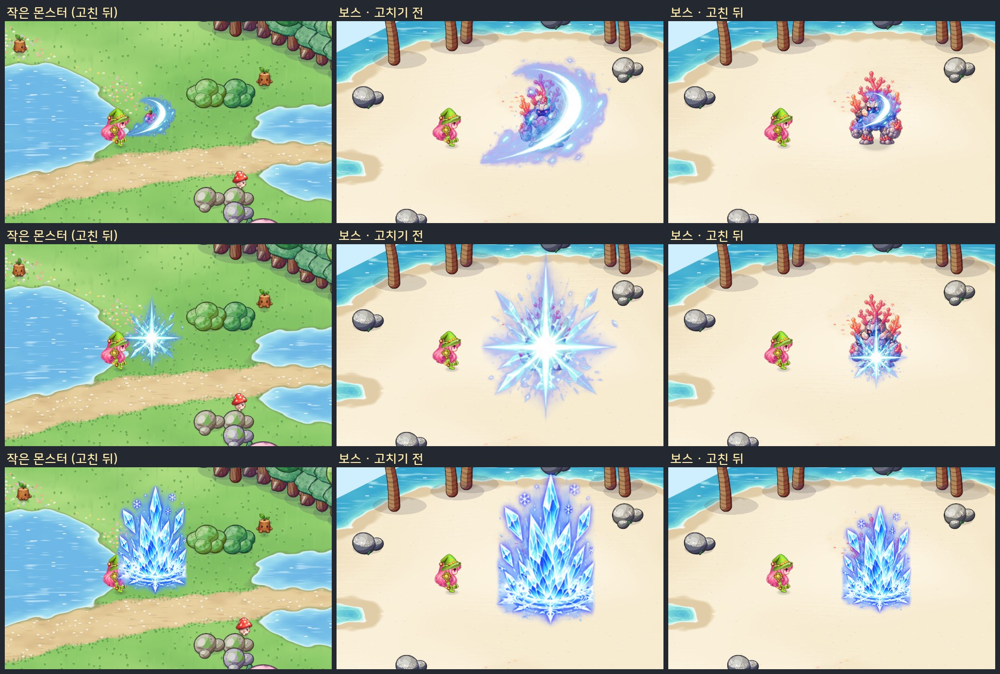

# 51. 버그 수정 — 스킬 이펙트가 몬스터 크기에 따라 커지던 것

검사 스킬 이펙트가 맞는 몬스터에 따라 커졌다 작아졌다 했다. 작은 몬스터에게 쓰면 작게, 큰 몬스터나 보스에게 쓰면 크게 그려졌다.
이제는 대상과 상관없이 **스킬마다 정해진 크기**로 그린다.

## 원인

대상 자리에서 터지는 스킬 연출 하나가 크기를 정할 때 **대상 몬스터의 몸 높이를 곱하고** 있었다.
몸 높이 0.8 유닛을 1배로 잡고, 그보다 큰 몬스터는 그만큼(최대 2.6배) 키웠다. 보스에게도 이펙트가 잘 보이게 하려던 계산이었다.
하지만 같은 스킬이 대상마다 다른 크기로 보여서, 스킬마다 정한 그림 크기가 지켜지지 않았다.

이 연출을 쓰는 스킬은 일곱 가지다.

- 검사: 강타 · 더블 슬래쉬 · 쿼드러플 슬래쉬 · 아머 브레이커 · 코마 어택
- 법사: 헬 파이어 · 아이스 필러

| 스킬 | 작은 몬스터 | 보스 (고치기 전) |
|---|---|---|
| 강타 | 0.68 | 1.54 (2.3배) |
| 더블 · 쿼드러플 슬래쉬 · 아머 브레이커 | 1.1 | 2.86 (2.6배) |
| 코마 어택 | 1.05 | 1.96 (1.9배) |
| 헬 파이어 · 아이스 필러 | 0.95 | 1.32~1.34 (1.4배) |

(숫자는 판정 순간의 그림 배율. 바닥에서 솟는 스킬은 화면 높이 상한이 있어서 덜 커졌다.)

## 고친 것

- 몸 높이를 곱하던 부분을 뺐다. 그림 크기는 스킬마다 정한 값 그대로다.
- **위치는 그대로 대상을 따라간다.** 베기는 대상 몸 가운데, 땅에서 솟는 스킬은 대상 발밑에서 터진다.
- **법사 스킬도 같이 고쳤다.** 요청은 검사 스킬이었지만 헬 파이어 · 아이스 필러가 같은 연출을 써서 같은 문제가 있었다.
- 기준 크기는 작은 몬스터에게 쓸 때의 크기(지금까지 대부분의 몬스터에서 보이던 크기)다.
- 보스에게도 같은 크기다. 큰 보스 몸에 비하면 이펙트가 작아 보이지만, 스킬마다 크기가 같은 쪽을 골랐다.
- 범위 스킬의 바닥 범위 표시와 실제 판정 범위는 원래 대상과 상관없어서 바뀌지 않았다. 다른 스킬 연출(범위 · 투사체 · 회복 등)에는 대상 크기를 곱하는 곳이 없었다.

## 확인

- 스킬 이펙트 Play 캡처의 끝에 검사를 하나 더했다.
  - 초록 들판의 가장 작은 몬스터(사과몬, 몸 높이 0.61)와 산호 골렘(보스, 몸 높이 2.42)에게 같은 연출을 띄운다.
  - 판정 순간의 그림 크기를 견주고, 다르면 실패로 알린다.
- 고치기 전 코드로 돌리면 일곱 스킬 모두 실패하고, 고친 뒤에는 모두 같은 크기로 통과한다.
- 게임 규칙 테스트 299개 통과 (화면 연출만 바뀌어 규칙 · 세이브는 그대로).
- 실제로 보스에게 스킬을 써 보는 확인은 아직 하지 않았다.
