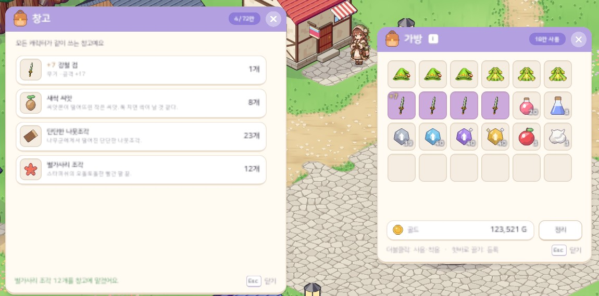
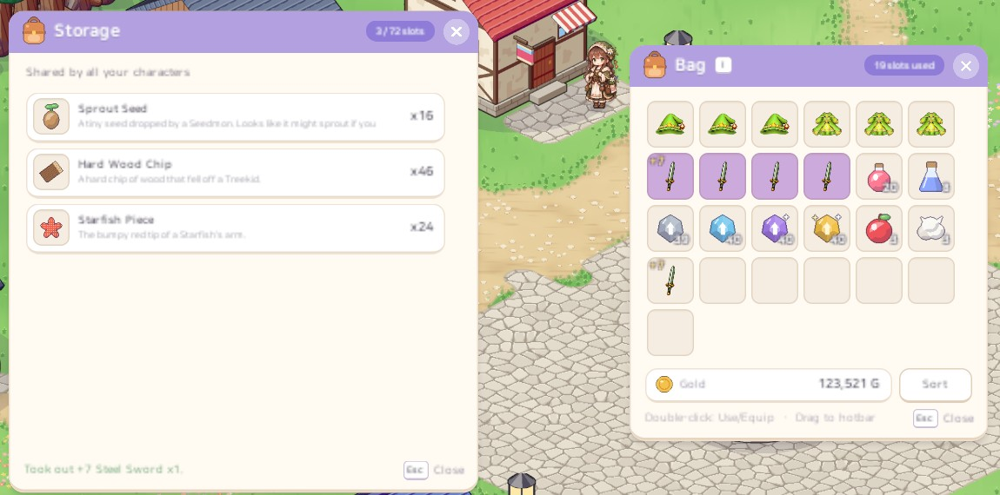

# 52. 공용 창고 — 모든 캐릭터가 같이 쓰는 창고와 창고 창

창고지기는 지금까지 대화 선택지 두 개만 있었다: *재료 모두 맡기기* 와 *맡긴 물건 모두 찾기*. 창고 안에 무엇이 있는지 볼 수 없었고, 물건을 하나씩 골라 넣거나 뺄 수도 없었다. 창고도 캐릭터마다 따로였다.

이번에 두 가지를 바꿨다.

- **창고 창**: 창고지기에게 *창고 열기* 를 하면 창고 창과 가방 창이 함께 뜬다. 창고 목록의 줄을 누르면 가방으로 꺼내고, 가방 칸을 누르면 창고에 맡긴다.
- **공용 창고**: 캐릭터 선택창의 세 캐릭터가 같은 창고 하나를 쓴다. 한 캐릭터가 맡긴 물건을 다른 캐릭터가 꺼낼 수 있다.

## 창고 창

- 한 줄 = 아이콘(등급 색 칸) · 이름 · 둘째 줄 · 개수. 이름은 강화한 장비면 "+7 강철 검"처럼 앞에 단계가 붙는다. 둘째 줄은 장비면 부위와 능력치, 포션 · 재료면 설명 첫 줄이다.
- 목록은 마우스 휠 · 끌기 · 오른쪽 막대로 넘긴다 (상점 창과 같은 스크롤 목록).
- **줄을 누르면** 그 칸을 통째로 가방으로 꺼낸다. 가방은 무제한이라 늘 들어간다.
- **창고 창이 열린 동안 가방 칸을 누르면** 그 칸을 통째로 맡긴다. 평소의 더블클릭 사용은 이때만 맡기기로 바뀌고, 우클릭 사용은 그대로다. 가방 칸에 마우스를 올리면 "클릭: 창고에 맡기기"가 보인다.
- 결과("빨간 포션 30개를 창고에 맡겼어요.")는 창 아래 안내 줄에 잠깐 뜬다. 머리 띠 오른쪽에는 쓴 칸 수(4 / 72칸)가 보인다.
- 창고는 맡기고 꺼낼 때마다 가방 [정리]와 같은 순서(장비 → 소모품 → 재료)로 정리되어, 같은 물건은 합쳐지고 목록 순서가 늘 같다.
- 창고를 열 때 닫혀 있던 가방 창은 창고를 닫으면 같이 닫힌다. Esc · 닫기 버튼 · 창고지기에게서 멀어지면 닫힌다.
- 대화의 *재료 모두 맡기기* · *모두 찾기* 는 그대로 남겼다 (진행 중인 수집 퀘스트 재료는 가방에 남기는 것도 그대로).

## 공용 창고

### 저장 위치

캐릭터 세이브는 칸마다 파일이 따로(`slot1~3.json`)다. 모든 캐릭터가 같이 쓰려면 창고를 캐릭터 세이브에 둘 수 없어서, **세이브 폴더에 공용 파일 `storage.json`** 을 따로 두었다.

- 캐릭터 세이브와 같은 방법(임시 파일에 쓴 뒤 바꿔 넣기 · `.bak` 백업)으로 저장한다. 세이브 폴더째 클라우드에 올리면 창고도 같이 올라간다.
- 파일이 없으면 빈 창고로 시작한다.
- **파일을 읽지 못하면 창고를 쓰지 않는다**(깨진 파일 · 더 새 버전의 게임이 쓴 파일). 빈 창고로 시작해 저장하면 맡긴 물건이 모두 사라지기 때문이다. 이때 창고지기는 장부를 읽을 수 없다고 말하고, 파일은 건드리지 않는다.
- 어느 마을의 창고지기든 같은 창고를 연다. 창고지기들의 대사("두두의 창고와 이어져 있어요")와도 맞다.
- 캐릭터를 지워도 공용 창고의 물건은 그대로다.

### 크기

72칸이다. 예전 캐릭터 창고가 24칸씩 셋이었으니, 세 캐릭터의 옛 창고를 모두 옮겨도 들어간다.

### 언제 저장하나 — 복제 막기

맡기거나 꺼낼 때마다 바로 **두 파일(캐릭터 세이브 · 공용 창고)을 모두** 저장한다. 순서는 **물건이 빠진 쪽을 먼저** 저장한다.

| 동작 | 먼저 | 다음 |
|---|---|---|
| 맡기기 (가방 → 창고) | 캐릭터 세이브 | 공용 창고 |
| 꺼내기 (창고 → 가방) | 공용 창고 | 캐릭터 세이브 |

- 두 저장 사이에 게임이 꺼져도 물건이 양쪽에 남아 복제되는 일이 없다.
- 캐릭터만 저장하고 창고를 나중에 저장하면 *불러오기(F9)* 로 이용할 수 있다. 맡긴 뒤 불러오면 가방에 물건이 돌아오는데 창고에도 남는다. 매번 둘 다 저장하면 불러와도 창고와 어긋나지 않는다.

### 옛 세이브

예전 세이브에는 캐릭터마다 창고 물건이 들어 있다. 그 캐릭터로 들어갈 때(그리고 불러올 때) 그 물건을 공용 창고로 옮기고 알림을 띄운다.

- 강화한 장비는 강화 단계 그대로, 같은 재료는 공용 창고의 것과 합친다.
- 공용 창고가 가득 차 못 옮긴 것은 그 캐릭터 세이브에 남겨 두었다가 다음에 들어올 때 다시 옮긴다 (알림으로 남은 개수를 알려 준다).
- 세이브의 창고 필드는 이름을 바꾸지 않고, 이제는 "아직 못 옮긴 옛 창고 물건"만 담는다.

## 정한 것

이슈에서 정해야 할 항목은 모두 기본안대로 했다.

- 저장 위치 = 캐릭터 세이브와 따로 공용 파일
- 마을마다 따로가 아니라 공용 창고 하나
- 맡기고 꺼낼 때마다 저장 (빠진 쪽 먼저)
- 모든 물건을 맡길 수 있다 (강화한 장비도 단계 그대로). 직업이 달라도 맡기고 꺼낼 수 있고, 착용 레벨이 안 맞으면 꺼내도 입지 못한다.
- 옛 창고는 공용 창고로 옮기고, 넘치는 것은 그 캐릭터에 남긴다

그 밖에 직접 정한 것:

- 한 번 누르면 칸을 **통째로** 옮긴다 (포션 30개 칸이면 30개). 한 개씩 나눠 옮기기는 넣지 않았다.
- 창고 크기 72칸 (위 「크기」).

## 확인

- 게임 규칙 테스트 305개 통과. 새로 넣은 테스트 6개는 다음을 확인한다.
  - 창고 크기, 캐릭터 칸 파일과 이름이 겹치지 않는지
  - 가방 칸을 통째로 맡기고 강화 단계 그대로 꺼내는지, 창고가 정리되는지
  - 창고가 가득 차면 못 넣은 만큼 같은 가방 칸에 남는지
  - 1번 캐릭터가 맡긴 물건을 3번 캐릭터가 같은 파일에서 꺼내는지, 공용 파일이 있어도 캐릭터 칸은 그대로 셋인지
  - 옛 캐릭터 창고를 옮기고, 넘치는 것은 그 캐릭터에 남는지
  - 읽지 못하는 파일 · 더 새 버전 파일을 덮어쓰지 않는지
- 한국어 · 영어 Play 화면 캡처로 창고 창과 가방 창을 확인했다. 캡처 중에 실제 클릭으로 가방 칸 네 개를 맡기고 첫 줄을 꺼낸 뒤 다음을 검사한다.
  - 개수 · 강화 단계가 그대로인지
  - 공용 창고 파일에 저장되었는지
  - 같이 연 가방 창이 같이 닫히는지
- 실제로 캐릭터를 바꿔 가며 손으로 써 보는 확인은 아직 하지 않았다.
