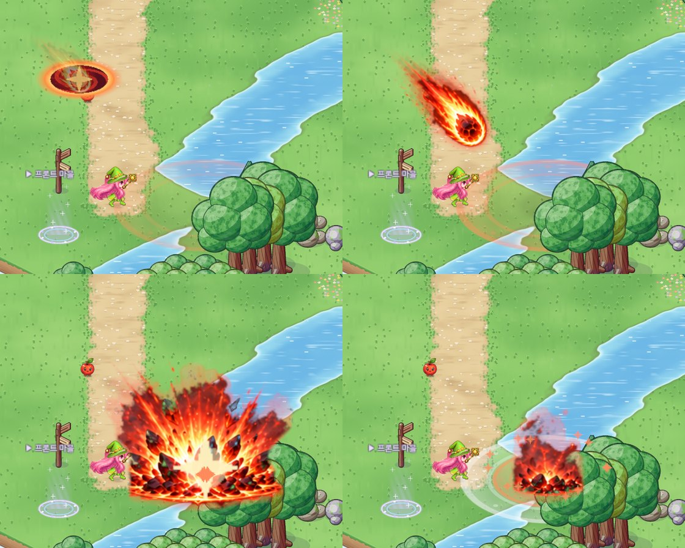

# 54. 메테오 연출 — 하늘에서 운석이 실제로 떨어진다

법사 스킬 메테오의 연출을 바꿨다. 예전에는 운석이 떨어지는 장면이 어색했다. 이제는 하늘에 불 구멍이 열리고, 운석이 그 구멍에서 빠져나와 땅으로 떨어진다.

## 예전 연출이 어색했던 까닭

메테오 그림은 사용자 제작 스킬 시트(21번 노트)의 한 줄이다. 앞 칸 셋은 꼬리를 끌고 떨어지는 운석, 뒤 칸들은 폭발이다.
예전에는 이 칸들을 **한 자리(닿을 곳)에서 차례로 바꿔 보였다.** 그런데 시트의 앞 칸 셋은 운석이 칸마다 다른 높이 · 위치에 그려져 있다.
그래서 운석이 움직이는 게 아니라 **순간순간 다른 자리에 나타났다 사라지는** 것처럼 보였다. 판정도 빨라서(0.55초) 떨어지는 시간이 거의 없었다.

## 바뀐 연출

시간 순서대로:

1. **불 구멍이 열린다 (0 ~ 0.2초)**: 닿을 곳의 왼쪽 위 하늘에 붉은 구멍이 열린다. 구멍 그림은 다른 연출 그림처럼 코드로 그렸다 (빛 테두리 · 가장자리 · 안쪽 소용돌이).
2. **운석이 떨어진다 (0.2 ~ 0.72초)**:
   - 시트에서 운석이 가장 또렷한 칸 한 장을 골라, 구멍에서 닿을 곳까지 **실제로 움직인다.**
   - 방향은 시트에 그려진 꼬리 방향(왼쪽 위 45°) 그대로다. 그래서 꼬리가 지나온 길을 가리킨다.
   - 처음엔 천천히, 땅에 가까울수록 빨라진다 (중력처럼).
   - 잔상 셋이 뒤따르고, 떨어져 나간 불똥이 뒤로 처지며 꺼진다.
   - 땅에는 그림자가 점점 커지고 짙어진다. 바닥의 범위 타원도 이때 차오른다.
   - 운석 그림은 꼬리까지 들어 있는 칸이라, 그림 가운데가 아니라 **바위 가운데**가 길을 따라가게 맞췄다.
3. **땅에 닿는 순간 (0.72초)**: 섬광 → 시트의 폭발 칸부터 끝까지 → 충격파 두 겹 · 불똥. 폭발 크기는 예전과 같다.

- **데미지는 땅에 닿는 순간 들어간다.** 판정이 0.55초에서 0.72초로 조금 늦어졌다. "그림이 터지는 순간 = 데미지 순간" 규칙은 그대로다.
- 범위 · 위력 · 재사용 대기 같은 규칙은 바꾸지 않았다.

## 확인

- 스킬 Play 캡처에 메테오 장면 둘을 더했다: 운석이 구멍에서 빠져나오는 때, 떨어지는 중간. 판정 순간 · 흩어지는 중간과 함께 네 장으로 본다.
- 처음에는 구멍이 운석보다 작아 보여서 크기를 키웠다.
- 게임 규칙 테스트는 그대로 통과한다 (화면 연출만 바뀌었다).
- 실제 사냥 중에 써 보는 확인은 아직 하지 않았다.
