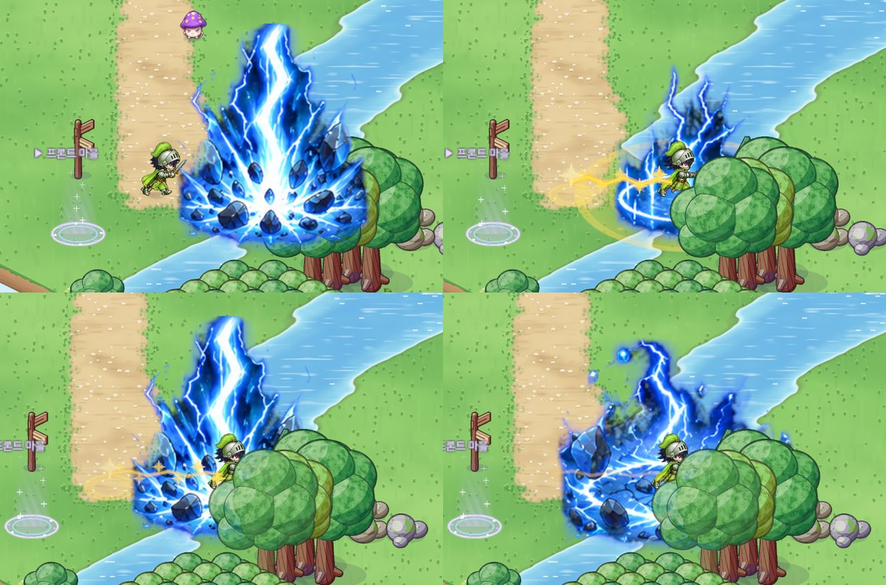

# 55. 뇌전 가르기 — 원 가운데로 뛰어들어 치는 스킬로

검사 2차 스킬 **뇌전 가르기**의 동작을 바꿨다.
예전에는 원 범위를 고르면 캐릭터가 그 자리(사거리 안)에 선 채로 멀리 있는 원 안을 쳤다.
이제는 플래시 슬래쉬처럼 **고른 원의 가운데로 뛰어들고, 도착한 자리를 가운데로 한 원을 친다.**

## 동작

- 원 범위(반경 4.1칸)를 고르는 방식은 그대로다. 사거리(4.5칸)도 늘리지 않았다.
- 고른 원 가운데가 사거리 밖이면 **먼저 걸어서 다가간 뒤** 뛰어든다. 다른 원 범위 스킬이 다가가서 쓰는 것과 같다.
- 뛰어드는 길에 물 · 나무 · 바위 같은 막힌 칸이 있으면 **그 앞에서 멈추고, 멈춘 자리를 가운데로** 원을 친다. 막힘이 없으면 꼭 원 가운데에 선다.
- **뛰어가는 길에 있는 몬스터는 맞지 않는다.** 지나간 길을 치는 플래시 슬래쉬와 다른 점이다. 뇌전 가르기는 도착한 자리 둘레만 친다.
- 데미지는 **도착한 뒤** 들어간다. 몸은 0.14초 동안 미끄러지고, 시트 그림이 터지는 순간(0.16초)에 판정한다.
- 위력 · MP · 재사용 대기 · 반경은 그대로다.

## 조준 미리보기 · 표시

- 사거리 안을 조준하면 원을 **실제로 도착할 자리**를 가운데로 그리고, 그 가운데에 흰 고리로 도착 자리를 따로 표시한다. 막힌 곳 너머를 고르면 원도 멈출 자리로 옮겨 보인다.
  사거리 밖이면 먼저 다가간 뒤 뛰어들기 때문에, 원은 고른 자리에 흐리게 보인다 (다른 원 범위 스킬과 같다).
- 미리보기와 실제 이동은 **같은 도착점 계산 하나**를 쓴다. 그래서 보이는 자리와 실제로 서는 자리가 어긋나지 않는다. 이 계산은 화면과 떨어진 게임 규칙 쪽에 있고, 플래시 슬래쉬(직선)도 같은 함수를 거친다.
- 스킬 종류는 "원형 범위 + 이동", 툴팁은 "뛰어들기 4.5칸 · 반경 4.1칸"으로 바뀌었다. 스킬 설명도 새 동작에 맞췄다. 모두 한국어 · 영어 둘 다.

## 연출

- 출발 자리에서 번쩍이고, **번개 줄기가 출발점에서 몸을 따라 자란다.** 몸과 같은 속도 곡선(처음에 빠르게)이라 줄기 끝이 몸에 붙어 간다. 길 위에는 몸이 지나가는 때에 맞춰 불꽃이 차례로 튄다.
- 도착 자리에서는 예전과 같은 시트 그림(번개 기둥 · 갈라지는 땅)이 터진다.
- **캐릭터가 원 가운데에 서다 보니 큰 번개 기둥에 완전히 가려졌다.** 스킬 그림은 보통 모든 것 위에 그리는데, 이 스킬만 도착 자리의 앞뒤 깊이로 정렬했다. 이제 그 자리에 선 캐릭터는 그림 앞에 보인다. 뒤에 있는 몬스터 · 나무는 그림에 가리고, 앞에 있는 것은 그림을 가린다.

## 확인

- 게임 규칙 테스트를 하나 더해 306개 모두 통과했다. 새 테스트는 다음을 확인한다.
  - 뇌전 가르기가 원 범위 + 이동이고, 사거리 밖이면 다가가는지
  - 막힘이 없으면 원 가운데에 정확히 서는지
  - 나무 앞에서 멈추고, 멈춘 자리 둘레만 맞는지 (고른 자리 너머의 몬스터는 맞지 않는다)
  - 플래시 슬래쉬의 도착점은 예전과 같은지
- 스킬 Play 캡처에서 대쉬 스킬은 뛰어드는 중간을 한 장 더 찍고, 다 도착한 뒤에 멈춰 찍게 했다.
  - 처음 캡처는 연출이 생기는 순간 시간을 멈춰서, 몸이 미끄러지기 전이라 출발 자리에 찍혔다.
  - 고친 뒤에는 캡처 기록으로 출발점 → 원 가운데에 도착한 것을 확인했다. 그다음 캐릭터가 그림에 가려지는 문제를 찾아 고쳤다.
- 실제로 사냥하며 써 보는 확인(조작감 · 뛰어드는 속도)은 아직 하지 않았다.
