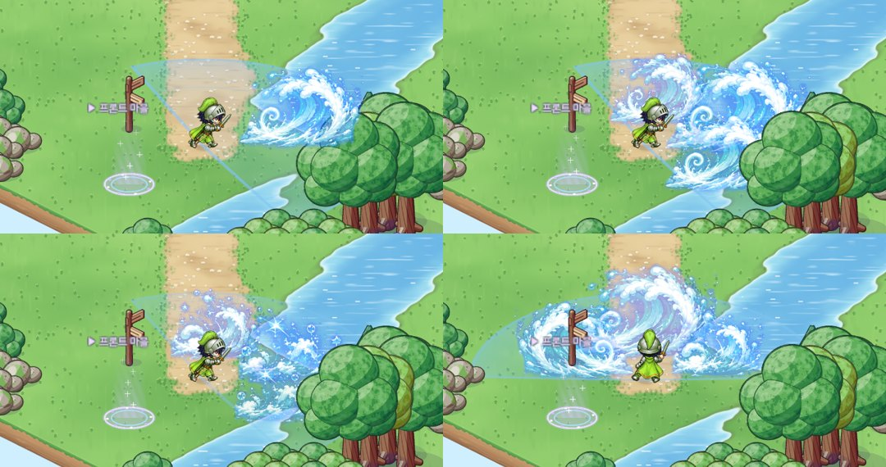

# 56. 파도 가르기 연출 — 부채꼴 범위를 덮는 물결 셋

검사 2차 스킬 **파도 가르기**는 앞쪽을 넓게 휩쓰는 부채꼴 범위 공격이다 (반경 6.8칸 · 175° — 거의 반원).
그런데 연출은 물결 그림 한 장(폭 약 3.4유닛)이 부채꼴 오른쪽에 솟는 것뿐이라, **범위에 비해 이펙트가 작아 보였다.**
이제는 부채꼴 호를 따라 **물결 셋**이 솟아 범위 대부분을 덮는다.

## 물결 배치

| 물결 | 방향 | 캐릭터에서 거리 | 크기 |
|---|---|---|---|
| 가운데 | 조준한 방향 | 반경의 58% | 예전보다 약 16% 크게 — 부채꼴 바깥 끝까지 닿는다 |
| 양쪽 | 조준 방향 ±54° (부채꼴 반각의 62%) | 반경의 50% | 가운데보다 조금 작게 |

- 거리와 크기는 **범위 반경에 대한 비율**로 정했다. 나중에 범위를 바꾸면 물결도 따라 커지거나 작아진다.
- 물결 그림은 돌리지 않고, 캐릭터에서 멀어지는 쪽으로 좌우만 뒤집는다 (땅에서 솟는 물결이라 돌리면 기울어 보인다).
- 세 물결이 **한쪽부터 0.05초 간격으로** 솟아 한쪽에서 다른 쪽으로 휩쓰는 느낌을 낸다.
  데미지는 예전처럼 한 번, 가운데 물결이 터지는 순간에 들어간다. 그래서 "그림이 터지는 순간 = 데미지 순간" 규칙이 그대로 지켜진다.
- 바닥의 부채꼴 범위 표시, 실제 판정 범위, 위력은 그대로다.

## 캐릭터를 가리지 않게

부채꼴이 캐릭터를 둘러싼 거의 반원이라, 물결이 캐릭터 바로 둘레에 솟는다. 스킬 그림은 보통 모든 것 위에 그려서 캐릭터 뒤(화면 위쪽)로 쓰면 물결이 캐릭터를 덮을 수 있었다.
그래서 **물결마다 그 물결이 선 땅의 깊이로 앞뒤를 정렬**했다.

- 캐릭터 뒤에 솟는 물결은 캐릭터 뒤에 그려진다.
- 캐릭터 앞(화면 아래쪽)의 물결은 캐릭터 앞에 그려진다.
- 앞에 있는 나무는 물결을 가린다 (실제 앞뒤 그대로).

## 확인

- 스킬 Play 캡처로 오른쪽으로 쓴 장면(판정 순간 · 흩어지는 중)을 예전과 견줬다.
- 위쪽(캐릭터 뒤)으로 쓰는 장면을 캡처에 새로 더해, 물결이 캐릭터를 가리지 않는 것을 확인했다.
- 처음에 넣은 상수 이름이 보스 연출 함수 이름과 겹쳐 컴파일이 멈춘 것을 고쳤다.
- 게임 규칙 테스트는 그대로 통과한다 (화면 연출만 바뀌었다).
- 실제로 사냥하며 써 보는 확인은 아직 하지 않았다.
