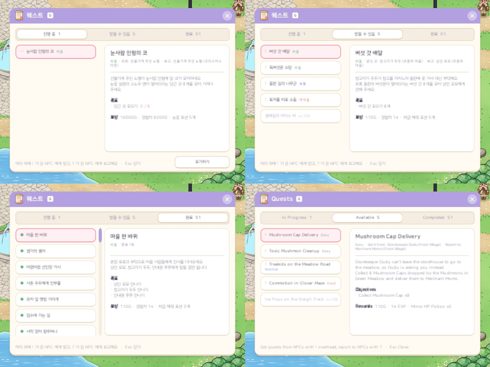

# 57. 퀘스트 보상 중심 성장 — 사냥 경험치 5% · 지역마다 퀘스트 10개

몬스터를 잡아 얻는 경험치만으로 레벨이 너무 빨리 올랐다. 후반에도 같은 레벨 몬스터 10마리 안팎이면 레벨업이 되어, 퀘스트 · 보스 · 지역 진행과 상관없이 사냥만으로 레벨이 올랐다.
그래서 사냥 경험치를 크게 낮추고, 레벨업 필요 경험치를 후반일수록 가파르게 하고, 그 대신 **퀘스트를 지역마다 10개로 늘려 퀘스트 보상으로 자라게** 했다.

## 경험치 공식

| | 예전 | 이번 |
|---|---|---|
| 몬스터 경험치 | 8 × 레벨^1.25 × 1.75 | 그 5% (모든 몬스터 · 보스 같은 비율, 최소 1) |
| 레벨업 필요 경험치 | 40 × 레벨^1.5 | 40 × 레벨^1.5 × (1 + (레벨 − 1) / 50) |

필요 경험치 곡선은 세 가지 후보(곡선 없음 · 완만 · 기본 · 더 가파르게) 중 가장 가파른 쪽을 골랐다. 레벨 1 은 예전과 같은 40 이고, 레벨 100 은 약 3배, 레벨 499 는 약 11배다.

같은 레벨 몬스터만 잡을 때 레벨업 한 번에 필요한 마릿수:

| 레벨 | 예전 | 이번 |
|---|---|---|
| 1 | 약 3마리 | 40마리 |
| 50 | 약 8마리 | 약 300마리 |
| 120 | 약 9마리 | 약 640마리 |
| 499 | 약 14마리 | 약 2,960마리 |

옛 세이브는 레벨을 그대로 두고, 경험치 막대가 차 있던 비율을 새 필요량으로 옮긴다. 막대가 줄거나 레벨이 내려가지 않는다.

## 퀘스트 30개 → 110개

- 지역마다 10개. 난이도 4단계를 섞었다.
  - **쉬움**: 지역 시작 레벨, 사냥 10~20 또는 수집 5~10
  - **보통**: 중반, 사냥 30~50 또는 수집 15~20
  - **어려움**: 후반, 여러 몬스터 사냥 + 수집 + 다른 NPC 찾아가기
  - **도전**: 끝, 그 지역 보스 · 큰 수집, 보상 강화석
- 지역 1~2 는 쉬움 · 보통이 많고(3 · 4 · 2 · 1), 그 뒤는 2 · 3 · 3 · 2. 전직 퀘스트도 개수에 든다.
- 마을 NPC 넷과 보스 필드 지기가 나눠 주고, 선행 퀘스트로 2~3단계 이야기 줄을 잇는다. 다른 NPC 에게 전해 주는 퀘스트도 섞었다.
- 대사는 NPC 의 그림 · 말투(소년 문지기는 반말, 촌장은 "허허" …)에 맞춰 한국어 · 영어로 썼다.
- **모든 퀘스트는 한 번만** 할 수 있다. 반복 퀘스트에 경험치를 크게 주면 노가다가 되기 때문이다. 예전에 반복으로 마친 기록이 있으면 마친 퀘스트로 읽는다.

## 보상 경험치는 계산으로

이슈의 기본안처럼 "레벨업 필요량의 몇 %"로 정하면, 레벨대가 좁은 앞 지역은 퀘스트가 레벨대의 60% 를 채우는데 레벨대가 넓은 지역 10~11 은 5% 밖에 안 됐다.
그래서 보상 경험치를 손으로 적지 않고 지역마다 나눈다.

- 지역의 레벨대(예: 지역 3 = Lv29 → 60)를 오르는 데 드는 경험치의 일정 몫을 그 지역 퀘스트들에 나눈다. 몫은 **지역 1~2 = 70%** (초반 부담을 퀘스트로 덜기), **그 뒤 = 50%**.
- 나누는 무게 = 난이도 무게(쉬움 0.15 · 보통 0.4 · 어려움 1 · 도전 1.75) × 그 퀘스트 필요 레벨의 레벨업 필요량. 같은 레벨이면 어려운 퀘스트가, 같은 난이도면 늦게 받는 퀘스트가 많이 준다.
- 숫자는 두 자리 유효숫자로 반올림한다 (57,384 → 57,000).
- 골드는 필요 레벨 몬스터 한 마리 골드 × 15 · 30 · 60 · 100 마리.

같은 레벨 몬스터를 12초에 한 마리씩 잡는다고 보면 (퀘스트를 하는 시간은 빼고):

| 지역 | 예전 | 사냥만 | 퀘스트를 모두 하면 |
|---|---|---|---|
| 1 (Lv1~20) | 0.3시간 | 7.3시간 | 2.2시간 |
| 3 (Lv29~60) | 0.8시간 | 28시간 | 14시간 |
| 6 (Lv103~150) | 1.5시간 | 105시간 | 53시간 |
| 10 (Lv230~400) | 6.8시간 | 994시간 | 497시간 |

## 화면

- 퀘스트 창 목록을 스크롤 목록으로 바꿨다 (완료 탭이 길어진다). 줄 끝과 상세 머리에 난이도를 색으로 보여 준다.
- "받을 수 있음" 탭은 바로 받을 수 있는 퀘스트를 먼저, 레벨이 모자란 퀘스트는 지금 레벨 + 10 안의 것만 필요 레벨 순으로 보여 준다.
- NPC 의 부탁이 4개를 넘으면 대화 목록에 "다른 부탁 보기 ▶" 가 붙는다.
- 보상 숫자에 천 단위 쉼표를 넣었다 (경험치 92,000).

## 작업 방법

퀘스트 80개의 대사를 한국어 · 영어로 쓰는 일이 커서, 지역별로 나눠 여럿이 동시에 썼다. 먼저 공통 규격(난이도별 레벨 · 목표량, 수집에 쓰면 안 되는 아이템, NPC 말투, 보상 아이템)을 정해 두고 같은 규격을 따르게 했다.

## 확인

- 게임 규칙 테스트 311개 통과. 새로 확인하는 것:
  - 경험치 곡선 · 사냥 경험치 5% · 옛 세이브 경험치 옮기기
  - 지역마다 퀘스트 8~12개, 난이도 4단계가 모두 있는지, 한 번만인지, 찾아가기 · 지역 보스 퀘스트
  - 지역 몫(70% · 50%)과 난이도 비례
  - "받을 수 있음" 탭의 순서와 범위
- 한국어 · 영어 화면 캡처로 퀘스트 창과 모든 퀘스트 대사의 길이를 확인했다. 영어 대사 12개가 대화 칸을 한 줄 넘어 짧게 고쳤다.
- 실제로 플레이하며 성장 속도를 느껴 보는 확인은 아직 하지 않았다.

## 남은 걱정

- 지역 10~11 은 퀘스트를 다 해도 사냥 시간이 매우 길다. 가파른 곡선을 고른 결과라, 해 보고 곡선이나 지역 몫을 조정한다.
- 뒤 지역의 높은 레벨 퀘스트는 사냥터 몬스터 레벨이 모자라 필요 레벨보다 꽤 낮은 몬스터를 잡는다.
- 수집 퀘스트가 제작 재료를 가져가는 경우가 있다.
