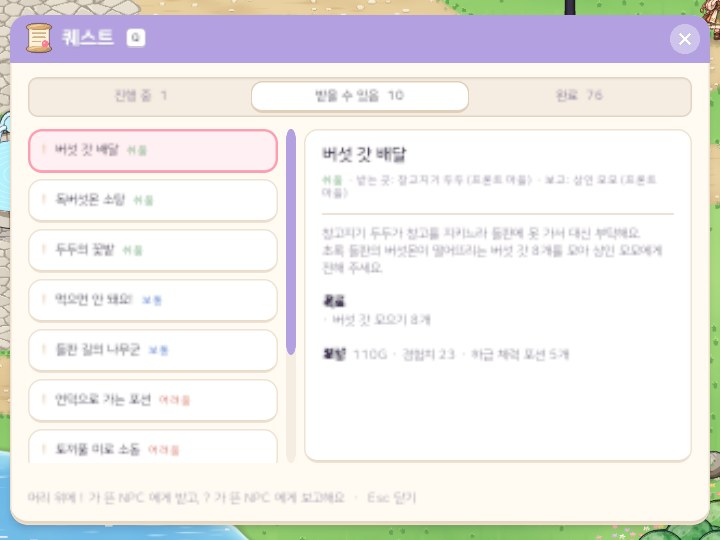

# 58. 퀘스트 15개 · 다음 퀘스트까지 이어지는 보상

57번에서 사냥 경험치를 크게 낮추고 퀘스트 보상으로 자라게 했는데, 지역 1 에서 새 캐릭터로 해 보니 **처음 퀘스트들을 다 해도 레벨 2** 였다.
레벨 1~2 의 쉬운 퀘스트 셋이 모두 70 경험치뿐이었고, 다음 퀘스트는 레벨 4 부터라 그 사이를 사냥(레벨 1 몬스터 = 경험치 1)으로 100마리쯤 채워야 했다.

원인은 셋이었다.

- 쉬운 퀘스트의 무게(레벨업 필요량의 15%)가 너무 작았다.
- 퀘스트 필요 레벨 사이에 빈 레벨이 많았다 (지역 10 은 15~24 레벨씩).
- 퀘스트가 채우는 몫(지역 1~2 = 70%, 그 뒤 = 50%)이 낮았다.

## 작업 내용

### 퀘스트 110개 → 165개

- 지역마다 5개(쉬움 1 · 보통 2 · 어려움 1 · 도전 1)를 더해 15개로 늘렸다.
- 새 퀘스트는 빈 레벨이 큰 자리에 넣었다. 예: 지역 1 = 레벨 2 · 3 · 5 · 7 · 14, 지역 10 = 241 · 247 · 268 · 293 · 332.
- 지역마다 찾아가기 · 다른 NPC 에게 전달하는 퀘스트를 하나 이상 넣고, 한 NPC 에게 동시에 4개 넘게 몰리지 않게 선행 퀘스트로 엇갈렸다.
- 새 도전 퀘스트는 보스를 또 잡게 하지 않고 큰 수집 · 여러 몬스터 사냥으로 했다.
- 대사는 NPC 그림 · 말투에 맞춰 한국어 · 영어로 썼다.

### 보상 나누기

- 퀘스트가 채우는 몫: **지역 1~2 = 레벨대의 100%, 지역 3~ = 80%**.
- 무게 = 난이도(쉬움 0.5 · 보통 1 · 어려움 2 · 도전 3) × 그 퀘스트 필요 레벨의 레벨업 필요량. 필요 레벨이 낮은 묶음부터 남은 경험치를 무게대로 나눈다.
- 다만 **같은 레벨에 받는 퀘스트 묶음을 다 하면 다음 묶음의 레벨까지 오르게**(× 지역 몫) 모자라는 만큼 그 묶음에 더 준다.
  - 처음에는 "지역 처음부터 쌓인 몫"으로 맞췄는데, 그러면 앞 퀘스트가 넉넉히 준 만큼 사냥할 몫이 지역 끝에 한꺼번에 몰렸다. 그래서 "그 묶음을 받은 자리에서 다음 묶음까지"로 바꿨다.
- 결과:
  - 지역 1~2 는 퀘스트만 따라가도 다음 퀘스트를 받을 레벨이 된다. 지역 1 새 캐릭터는 첫 다섯 퀘스트로 레벨 4, 지역 1 퀘스트를 다 하면 레벨 20.
  - 지역 3~ 은 퀘스트 사이마다 더 사냥할 몫이 20% 를 넘지 않는다 (모두 합하면 레벨대의 84~89%).
- 필요 레벨을 바꾸거나 퀘스트를 더하면 보상은 저절로 다시 계산된다. 숫자는 세 자리 유효숫자로 반올림한다.

같은 레벨 몬스터를 12초에 한 마리씩 잡는다고 볼 때, 퀘스트 사이에 더 하는 사냥 시간 (퀘스트 목표의 사냥은 빼고):

| 지역 | 사냥만 | 57번 | 이번 |
|---|---|---|---|
| 1 | 7시간 | 2.2시간 | 0 |
| 3 | 28시간 | 14시간 | 약 2.8시간 |
| 6 | 105시간 | 53시간 | 약 11시간 |
| 10 | 994시간 | 497시간 | 약 129시간 |

## 확인

- 게임 규칙 테스트 313개 통과. 새 테스트:
  - 지역 퀘스트를 받을 수 있는 대로 차례로 하며(사냥 목표의 경험치 포함), 다음 퀘스트까지 더 사냥할 경험치가 지역 몫의 한도 안인지
  - 보상 나누기 규칙 (무게대로 나누기 · 모자라는 만큼 더 주기 · 80% 지역)
- 한국어 · 영어 화면 캡처로 모든 퀘스트 대사의 길이를 확인했다. 기존 퀘스트 하나의 영어 대사가 한 줄 넘쳐 줄였다.

## 문제와 해결

| 문제 | 해결 |
|---|---|
| 지역 1 의 처음 퀘스트들을 다 해도 레벨 2 | 쉬운 퀘스트 무게를 올리고, 묶음마다 다음 퀘스트 레벨까지 오르게 모자라는 만큼 더 준다 |
| 사냥할 몫이 지역 끝에 몰림 | 모자라는 몫을 "처음부터 쌓인 몫"이 아니라 "그 묶음을 받은 자리부터"로 잰다 |
| 뒤 지역은 필요 레벨에 맞는 몬스터가 모자람 | 그 지역에서 가장 레벨이 높은 몬스터를 쓴다 (같은 몬스터를 여러 퀘스트에서 잡게 된다) |

## 남은 걱정

- 레벨대가 넓은 지역 10 · 11 은 퀘스트 하나가 10~25 레벨 분량을 준다.
- 뒤 지역은 같은 몬스터가 여러 퀘스트에 겹치고, 수집 퀘스트 몇 개가 제작 재료를 가져간다.
