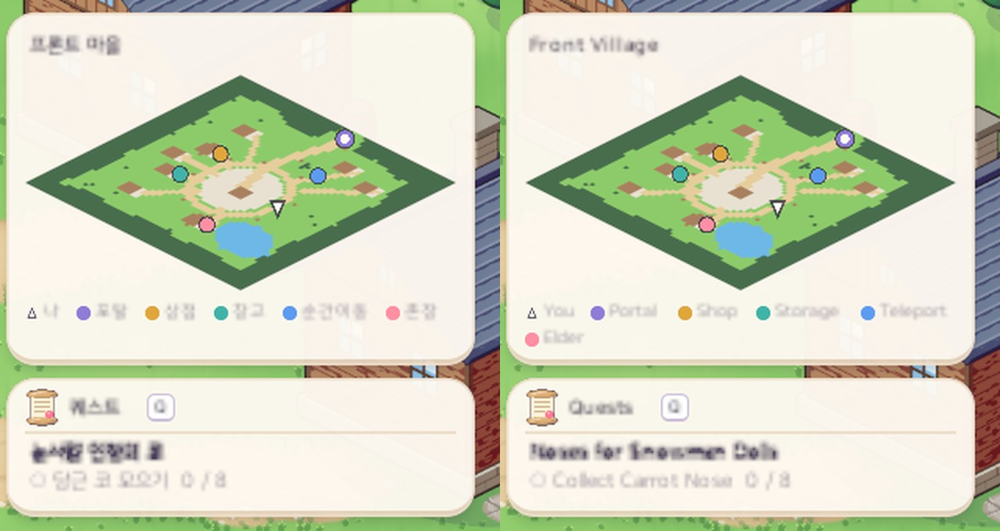
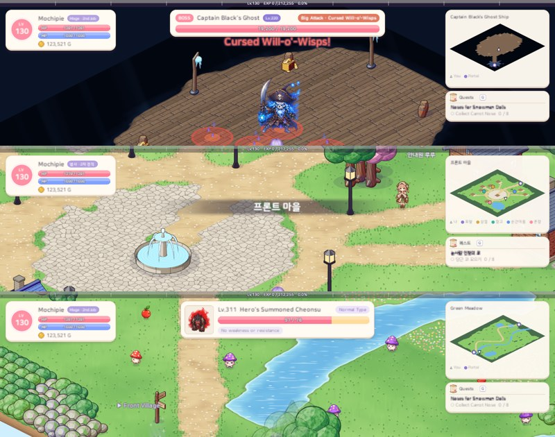

# 60. 미니맵 — 내 위치 · NPC · 포탈

마을은 약 64×64, 사냥터는 약 100×100 칸이라 포탈과 NPC 가 멀리 있으면 길을 찾기 어려웠다. 화면 오른쪽 위에 **지금 있는 맵 전체를 작게 그린 미니맵**을 넣었다.

## 작업 내용

### 자리와 보기

- 화면 오른쪽 위 맨 위에 폭 300 의 크림색 판: 맵 이름 · 맵 그림 · 범례. 퀘스트 진행 카드는 그 아래로 내렸다.
  - 카드 아래에 두면 진행 중인 퀘스트 수에 따라 미니맵이 위아래로 움직여서, 높이가 정해진 미니맵을 위에 두었다.
- 맵 **전체**를 늘 한 번에 보여 준다.
- **게임 화면과 같은 방향**으로 그린다. 그리드를 그대로 그리면 게임 화면과 45° 어긋나 방향이 헷갈린다.
  - 아이소 시점에서 W×H 맵이 화면에 차지하는 상자는 가로 (W + H)/2 · 세로 (W + H)/4 라서 **맵 크기와 상관없이 늘 2:1** 이다. 그래서 2:1 판 하나에 정사각형 마을이든 50×150 통로든 꼭 맞는다.

### 무엇을 그리나

- 칸마다 모습: 걸을 수 있는 바닥 · 길 · 광장 · 물 · 막힌 칸(나무 · 덤불 · 바위) · 장식물(집 · 분수 · 바위 언덕).
  - 색은 그 맵 바닥 그림의 팔레트를 그대로 쓴다 — 사막은 모래, 눈 지역은 눈밭, 드래곤 성은 용암.
  - "걸을 수 있는 칸" 은 이동 판정과 같은 기준이라 미니맵에서 열린 곳 = 실제로 걸어갈 수 있는 곳이다.
- 점:
  - 내 위치 = 흰 화살표 (바라보는 쪽, 움직이면 따라간다)
  - 포탈 = 보라 고리
  - NPC = 역할마다 다른 색 (상점 금색 · 창고 청록 · 순간이동 하늘 · 촌장 분홍 · 전직 주황 · 보스 입구 빨강)
  - 점에 마우스를 올리면 이름 · 역할이 뜬다. 몬스터는 그리지 않는다.
- 범례는 그 맵에 있는 표시만, 한국어 · 영어로.

### 만드는 방법

- 규칙(칸 모습 · 그리드 ↔ 미니맵 좌표 · 점 목록 · 범례)은 게임 엔진과 상관없는 규칙 코드에, 그리기는 화면 코드에 나눴다.
- 맵 그림은 맵에 들어갈 때 한 번 칠해 두고(픽셀마다 네 군데를 찍어 섞어 가장자리를 부드럽게), 지금 맵 하나만 기억한다. 그 뒤엔 화살표만 움직인다.
- 미니맵 판은 클릭을 막지 않고 점만 마우스를 받는다.

## 확인

- 게임 규칙 테스트 325개 통과. 새 테스트:
  - 모든 맵에서 미니맵의 칸 분류가 실제 이동 판정과 같은지
  - 모든 맵의 NPC · 포탈 점이 판 안의 제 칸에 찍히는지
  - 마름모가 2:1 상자에 꼭 맞고 위 · 오른쪽 방향이 게임 화면과 같은지
  - 맵 밖 위치가 판 끝에 머무는지, NPC 역할마다 표시가 다른지
- 한국어 · 영어 화면 캡처로 마을 · 사냥터 · 보스 필드에서 다른 화면 요소와 겹치지 않는 것을 확인했다.
- 점 툴팁과 화살표가 따라오는 모습은 플레이로 확인이 필요하다.

## 문제와 해결

| 문제 | 해결 |
|---|---|
| 맵마다 크기 · 비율이 달라 판 크기를 정하기 어려움 | 아이소 투영 상자는 늘 2:1 → 2:1 판 하나 |
| 퀘스트 카드 아래에 두면 미니맵이 위아래로 움직임 | 높이가 정해진 미니맵을 위에, 카드를 그 아래에 |
| 장식물이 덮은 칸을 픽셀마다 찾으면 느림 | 칸 모습을 맵마다 한 번 표로 만들고 그 표에서 칠한다 |
